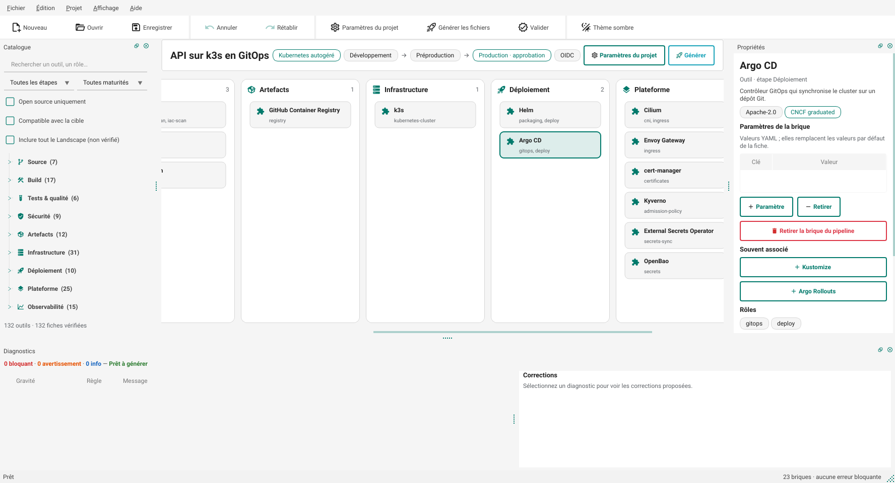
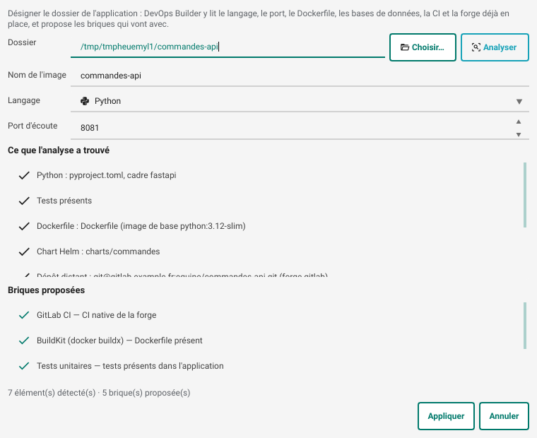
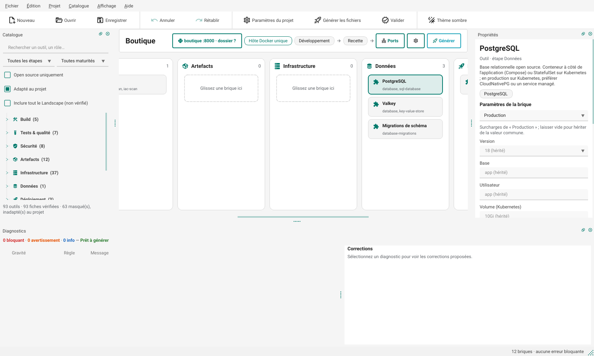

# DevOps Builder

[](https://github.com/denvi44/devops-builder/actions/workflows/ci.yml) [](LICENSE)

Application de bureau Python, en Material Design, pour composer un pipeline DevOps en posant des briques issues du [CNCF Landscape](https://landscape.cncf.io/). Un moteur de règles bloque les combinaisons incohérentes avant de générer les fichiers à committer.







## Ce que fait l'application

On pose des briques du CNCF Landscape dans les étapes d'un pipeline ; l'application vérifie l'ensemble et génère
les fichiers à committer.

- **Part de l'application** : analyse du dossier (langage, port, Dockerfile, CI, bases, migrations) et briques proposées en conséquence ; assistant de démarrage pour un projet neuf.
- **Contrôle continu** : 54 règles signalent les combinaisons incohérentes, chacune avec sa correction en un clic.
- **Génère** la CI (GitLab CI, GitHub et Gitea Actions, Jenkins, Woodpecker, Tekton, Azure Pipelines, CodeBuild, Cloud Build), le déploiement (Compose, Helm, Kustomize, Ansible, Argo CD, Flux), l'infrastructure Terraform / OpenTofu sur six clouds et la plateforme Kubernetes.
- **Environnements** : chaîne de promotion avec approbation de la production, ports et surcharges par environnement.
- **Données et secrets** : bases autogérées, opérateur ou managées, sauvegardes ; secrets par variables CI, SOPS, Vault / OpenBao ou coffre du cloud.
- **Sécurité et qualité** : SAST, analyse d'images, signature, DAST avec ZAP, connexion unique (Keycloak, Dex).
- **Exploitation** : supervision (Prometheus, Grafana, Zabbix), dimensionnement des machines, Renovate.
- **Mode d'emploi** : `docs/mise-en-route.md`, les gestes à faire une fois, avec les commandes déjà remplies.
- **Prise en charge déclarée** : chaque brique est *prise en charge*, *expérimentale* ou *à configurer à la main* ([matrice](docs/prise-en-charge.md)) ; des scénarios de bout en bout exécutent les fichiers générés pour de vrai, chaque nuit.
- **Livraison** : validation locale, test dans kind, écriture prudente (fichiers retouchés préservés), export Git avec demande de fusion.
- **Accessible** : utilisable au clavier seul, lu par les lecteurs d'écran (arbres NVDA et Orca vérifiés en CI), contrastes vérifiés dans les deux thèmes, texte agrandi jusqu'à 200 % ([état et limites](docs/accessibilite.md)).

Le **[guide de l'utilisateur](https://denvi44.github.io/devops-builder/)** mène de l'installation au premier déploiement, avec quatre tutoriels (hôte Docker, k3s en GitOps, Amazon EKS, souverain SecNumCloud) ; ses sources sont dans [docs/guide/](docs/guide/index.md). Le détail de chaque fonction, avec les captures d'écran : [docs/fonctionnalites.md](docs/fonctionnalites.md).

## Installation

**Avec Python** (3.11 à 3.14), par [pipx](https://pipx.pypa.io/) qui isole l'application :

```bash
pipx install izinum-devops-builder          # sous macOS : pipx install --python python3.13 izinum-devops-builder
pipx inject izinum-devops-builder check-jsonschema actionlint-py shellcheck-py   # linters de la validation, facultatif
devops-builder                              # l'interface ; devops-builder --help pour la ligne de commande
```

Le paquet s'appelle `izinum-devops-builder` sur PyPI (« devops-builder » y était déjà pris) ; la commande reste
`devops-builder`. PySide6 est limité aux versions 6.11 (la 6.12.0 fait planter l'interpréteur) et ne s'installe pas
sous Python 3.15. Sous Linux, Qt a besoin des bibliothèques système habituelles (`libxkbcommon`, `libEGL`,
`fontconfig`, `libxcb-cursor0`).

**Sans Python** : chaque [publication](https://github.com/denvi44/devops-builder/releases) porte un exécutable
pour Linux x86-64 (`.tar.gz`, glibc 2.35 ou plus, Ubuntu 22.04 et suivantes), Windows x86-64 (`.zip`) et macOS
Apple Silicon (`.zip` contenant `DevOps Builder.app`). Décompresser, puis lancer `devops-builder` (Linux),
`devops-builder.exe` (Windows) ou l'application. Les exécutables ne sont **pas signés** pour l'instant :

- Windows : SmartScreen avertit au premier lancement (« Informations complémentaires » → « Exécuter quand même ») ;
- macOS : Gatekeeper refuse une application téléchargée non notariée ; après vérification (ci-dessous), lever la
  quarantaine avec `xattr -dr com.apple.quarantine "DevOps Builder.app"`.

Ce qui remplace la signature pour l'instant : chaque fichier publié (exécutables, paquet PyPI) porte une
attestation de provenance qui prouve qu'il a été construit par le workflow `publication.yml` de ce dépôt, à partir
de l'étiquette publiée, et la publication donne leurs sommes SHA-256 (`SHA256SUMS`).

```bash
gh attestation verify devops-builder-0.19.0-macos-arm64.zip --repo denvi44/devops-builder
sha256sum -c SHA256SUMS --ignore-missing
```

Pour travailler sur le code :

```bash
python -m venv .venv
source .venv/bin/activate          # Windows : .venv\Scripts\activate
pip install -e ".[dev]"
devops-builder                     # ou : python -m devops_builder
```

## Utilisation

| Action | Comment |
| --- | --- |
| Ajouter une brique | Glisser depuis le catalogue, ou double-clic / Entrée |
| Déplacer une brique | Glisser vers une colonne compatible, ou Alt+← / Alt+→ (saute à l'étape autorisée suivante) ; Alt+↑ / Alt+↓ dans son étape |
| Retirer une brique | Suppr, ou bouton dans Propriétés |
| Corriger un diagnostic | Sélectionner le diagnostic puis cliquer une correction (Entrée applique la première) |
| Nouveau projet | Ctrl+N : assistant, qui commence par le dossier de l'application ; Ctrl+Maj+N : projet vide |
| Application | Ctrl+Maj+A, ou la carte de l'application dans la barre du projet : dossier, analyse, langage, port |
| Paramètres du projet | F2 : cible, langage, SecNumCloud, OIDC, politique de licence ; onglet Environnements (type, cluster, hôte Docker partagé, décalage des ports) |
| Réseau (2D, 3D isométrique) | Ctrl+Maj+R, ou le bouton « Vues » de la barre du projet |
| Ports | Ctrl+Maj+P, ou le bouton « Vues » de la barre du projet |
| Surcharger un paramètre | Sélectionner la brique, choisir l'environnement au-dessus du formulaire ; un champ vide hérite de la valeur commune |
| Générer | Ctrl+G : aperçu des fichiers, puis export vers Git, dans un dossier (avec différences) ou en .zip |
| Valider | Ctrl+Maj+V : contrôles locaux, puis test dans kind |
| Annuler / rétablir | Ctrl+Z / Ctrl+Y |
| Rechercher | Ctrl+F ; Ctrl+2 pour le pipeline, Ctrl+3 pour les diagnostics |
| Thème sombre | Ctrl+T |
| Taille du texte | Affichage › Taille du texte (100 à 200 %), Ctrl++ et Ctrl+- |
| Ouvrir un projet depuis un terminal | `devops-builder projet.devops.yaml` |

Quatre projets d'exemple sont fournis dans **Fichier › Ouvrir un exemple** : un site web sur hôte Docker, une API sur k3s en GitOps, une plateforme AWS EKS en OpenTofu et une boutique avec PostgreSQL, Valkey et migrations sur un hôte partagé.

### En ligne de commande

```bash
devops-builder check projet.devops.yaml                 # --json ; code retour 1 si erreur bloquante
devops-builder generate projet.devops.yaml -o sortie/   # --dry-run, --overwrite, --force, --json
devops-builder validate projet.devops.yaml              # --offline, -v, --json ; code retour 1 si un contrôle échoue
devops-builder test-kind projet.devops.yaml --env dev --app-dir ../code
devops-builder export-git projet.devops.yaml --repo ../depot   # --branch, --no-push, --no-request
devops-builder catalog-check                            # --offline, --refresh, --apply, --report rapport.md
devops-builder catalog-import "Keptn"                   # --id, --stage, --license, --offline
devops-builder landscape-refresh                        # --source landscape.yml, --reset
devops-builder scan ../mon-app                          # --json : ce que l'analyse trouve
devops-builder init ../mon-app -o mon-app.devops.yaml   # --hosting, --cloud, --envs, --database
```

`generate` n'écrase plus les fichiers retouchés à la main : il les liste, et `--overwrite` les remplace.

Les codes de sortie (0 succès, 1 problème trouvé, 2 utilisation ou fichier illisible) et la sortie `--json` forment un contrat stable, décrit dans [docs/ligne-de-commande.md](docs/ligne-de-commande.md). Le format du fichier projet, ses migrations et la promesse de compatibilité sont dans [docs/format.md](docs/format.md) : un fichier de n'importe quelle version précédente s'ouvre, un fichier d'une version plus récente garde ses champs inconnus, un format plus récent est refusé avec un message clair. Les changements de chaque version sont dans [CHANGELOG.md](CHANGELOG.md).

## Ce qui est généré

| Domaine | Formats |
| --- | --- |
| CI | GitLab CI, GitHub Actions, Gitea Actions, Jenkinsfile, Woodpecker, Tekton, Azure Pipelines, AWS CodeBuild, Google Cloud Build |
| Déploiement | Docker Compose, chart Helm, Kustomize, Application Argo CD, Flux (GitRepository + Kustomization ou HelmRelease), playbooks Ansible |
| Données | Services Compose (volume, santé, `deploy/secrets.sh`, `scripts/db-backup.sh`, `scripts/db-restore.sh`), bases du poste (`dev/db/`), sauvegardes CloudNativePG (ObjectStore, ScheduledBackup, bucket et identité Terraform), StatefulSet et Secret dans le chart ou la base Kustomize, Cluster CloudNativePG, Terraform des bases managées (`outputs.tf`), service `migrate` ou initContainer de migrations |
| Mise en route | `docs/mise-en-route.md` : commandes de mise en place, dans l'ordre, propres au projet |
| Identité | Keycloak (service Compose et sa base, ou opérateur et ressource `Keycloak`), realm en Terraform (`infra/keycloak/`), Dex (chart ou service Compose), valeurs OIDC d'Argo CD et de Grafana, `auth/oidc` du coffre |
| Secrets | `.sops.yaml`, `scripts/secrets-fetch.sh`, `scripts/secrets-seed.sh` et `scripts/vault-setup.sh` (SOPS, Vault, OpenBao, coffres des clouds), `ClusterSecretStore` et `ExternalSecret` (chart ou overlays), configuration serveur de Vault et OpenBao (Compose), secrets écrits par Terraform dans AWS Secrets Manager, Google Secret Manager et Azure Key Vault, identité du contrôleur External Secrets (EKS Pod Identity, Workload Identity de GKE et d'AKS) |
| Infrastructure | Terraform / OpenTofu : machines de déploiement des six clouds (cloud-init, pare-feu, sortie `hosts`), providers épinglés, backend d'état chiffré et verrouillé (S3, GCS, Blob, Scaleway, OVHcloud ; Outscale sans verrou), ressources AWS, Google Cloud, Azure, OVHcloud, Scaleway, `outputs.tf`, `terraform.tfvars.example`, `.gitignore`, `.tflint.hcl` |
| Clusters autogérés | Scripts d'installation k3s, RKE2, kubeadm, MicroK8s, kind, minikube, réglés selon le CNI et l'entrée choisis (par exemple, k3s sans Flannel ni Traefik intégrés quand Cilium et Traefik sont dans le pipeline) |
| Plateforme | `platform/install.sh` (charts Helm officiels, sans réinstaller ce que le cluster fournit déjà) ou services Compose sur hôte Docker |
| Dépendances | `renovate.json`, `.github/dependabot.yml` (écosystèmes déduits du langage, du build, de la CI et de l'IaC) |
| Observabilité managée | Module CloudWatch sur EKS, Azure Monitor (Log Analytics) sur AKS ; Cloud Monitoring, intégré à GKE, est noté dans le rapport |
| Authentification cloud | OIDC par défaut : rôle IAM, Workload Identity Federation, fédération Entra ID |
| Outillage local | `scripts/tf-inventory.sh` (inventaire Ansible depuis les sorties Terraform), `scripts/test-kind.sh` (Helm ou Kustomize), `scripts/ci-variables.sh` (GitLab, GitHub, Gitea, Azure Pipelines), `scripts/tf-floci.sh` et `dev/floci/` (émulateur AWS) |
| Promotion | Un job de déploiement par environnement, enchaînés dans l'ordre. Approbation : job manuel (GitLab), environnement avec relecteurs (GitHub, Gitea, Azure Pipelines), `input` (Jenkins), événement manuel (Woodpecker), fichiers séparés à déclencher après validation (Tekton, CodeBuild, Cloud Build) |

Les fichiers générés sont un point de départ à relire. Les tests valident chaque sortie YAML contre les schémas officiels (GitLab CI, GitHub Workflows, Azure Pipelines, Cloud Build, Woodpecker, Compose, Renovate, Dependabot) et passent les workflows GitHub dans actionlint. `helm lint` n'est pas lancé par les tests ; `tofu validate` l'est sur toutes les piles de l'instantané quand `DEVOPS_BUILDER_TOFU_MIRROR` désigne un miroir local de providers (le module EKS, servi par le registre, y est remplacé par un module factice). Le bouton **Valider** lance les deux sur le poste quand les outils et le réseau sont disponibles.

## Organisation du code

```
devops_builder/
  model.py          fiches, projet, format .devops.yaml
  catalog.py        chargement des fiches + index du Landscape
  rules.py          moteur de règles, handlers génériques, corrections
  ir.py             représentation intermédiaire neutre du pipeline
  generators/       ci, deploy, data (bases), iac, platform, extras (dépendances, clusters), report
  ui/               interface PySide6 + qt-material (a11y.py : traduction de Qt, annonces, anneau de focus ;
                    audit.py : audit d'accessibilité)
  messages.py       erreurs du système, de YAML et des commandes traduites en français
  params.py         validation et valeurs effectives des paramètres (surcharges par environnement)
  starter.py        assistant de démarrage : réponses → projet
  validate.py       contrôles locaux des fichiers générés
  sync.py           différences et écriture prudente (manifeste d'empreintes)
  gitexport.py      branche, commit, push, demande de fusion
  health.py         entretien du catalogue (Landscape, GitHub, GitLab.com)
  catalog_edit.py   fiches personnelles et corrections
  landscape.py      index du Landscape : construction, rafraîchissement, écarts
  userdata.py       dossier personnel (DEVOPS_BUILDER_HOME)
  ports.py          ports par environnement, hôtes partagés, conflits
  databases.py      bases du pipeline : moteurs, modes (autogérée, opérateur, managée), connexion
  appscan.py        analyse du dossier de l'application
  compat.py         briques adaptées au projet (filtre de la palette)
  data/ports.yaml   ports par défaut des briques et leur usage
  suggest.py        briques souvent associées
  data/catalog/     fiches YAML (une par outil)
  data/params.yaml  schémas des paramètres de briques
  data/suggestions.yaml  briques souvent associées
  data/rules/       une règle YAML par fichier
  data/examples/    projets de référence
tools/
  build_landscape_index.py   rafraîchit l'index depuis landscape.yml
  screenshot.py              captures hors écran de l'interface et du guide
  audit_accessibilite.py     audit d'accessibilité hors écran, les deux thèmes
  arbre_accessibilite.py     arbre lu comme Orca (AT-SPI) ; arbre_uia.py : comme NVDA (UI Automation)
  tutoriels.py               projets des tutoriels du guide
  miroir_tofu.py, publication.py   miroir de providers OpenTofu ; vérification d'une publication
tests/              règles, générateurs, interface (hors écran), non-régression
  golden/           sorties figées de 183 projets (exemples, matrice, échantillon de l'assistant, environnements, ports, données, IaC, Floci, Ansible et machines)
  data/legacy/      projets enregistrés par chaque version, de la 0.1 à la 0.19
  minihelm.py       rendu des gabarits Helm générés, sans le binaire helm
tools/compare_captures.py  écart visuel entre deux séries de captures
```

### Ajouter un outil

Pour un usage personnel ou d'équipe, passer par le catalogue personnel (palette › clic droit › Créer une fiche, ou `devops-builder catalog-import`). Pour l'ajouter à l'application, ajouter une entrée dans un fichier de `data/catalog/` : étape principale (`stage`) et, s'il le faut, étapes secondaires (`extra_stages`), rôles, cibles (`hosting`), capacités fournies et requises, forge, fournisseur, cycle de vie, date de vérification. Le schéma est validé au chargement.

Si l'outil a des réglages, décrire ses paramètres dans `data/params.yaml` : libellé, type, valeur par défaut (`{app}` = nom de l'image du projet), valeur d'exemple, liste de choix ou de suggestions, motif et explication du format. Le formulaire et les règles R32 à R34 s'en déduisent. Une valeur par défaut qui ne respecte pas son propre motif est refusée au chargement.

Un outil ne peut être posé que dans `stage` ou `extra_stages`. Par exemple, Ansible va en Infrastructure ou Déploiement, et Trivy en Sécurité ou Tests & qualité. Les entrées non vérifiées du Landscape reçoivent des étapes déduites de leur sous-catégorie. La règle R25 bloque la génération si un fichier `.devops.yaml` édité à la main place une brique ailleurs, et propose de la déplacer.

### Ajouter une règle

Créer `data/rules/R45_....yaml` avec un `type` existant (`exclusive_role`, `conflict_pair`, `requires`, `requires_generic`, `lifecycle`, `target_mismatch`, `params`…), puis ajouter son cas dans `tests/test_rules.py`. Un nouveau type de règle s'écrit comme un handler dans `rules.py`.

### Rafraîchir le Landscape

Depuis l'application ou avec `devops-builder landscape-refresh`, pour son propre index. Pour l'index livré avec l'application :

```bash
curl -LO https://raw.githubusercontent.com/cncf/landscape/master/landscape.yml
python tools/build_landscape_index.py landscape.yml
```

Les deux signalent les entrées ajoutées, retirées et nouvellement archivées, pour savoir quelles fiches revoir.

## Tests

```bash
pip install -e ".[dev]"
QT_QPA_PLATFORM=offscreen pytest
```

976 tests : un par règle, l'application de chaque correction proposée, une matrice de combinaisons CI × déploiement × cloud × environnements validées contre les schémas, avec contrôle qu'aucune brique n'y reste sans fichier, les 15 300 combinaisons de l'assistant (aucune ne doit produire d'erreur bloquante), la validation, l'écriture prudente, l'export Git vers des dépôts locaux (dont les options de push GitLab), les scripts kind et variables CI contre des outils factices et une fausse API Gitea, l'entretien du catalogue contre une fausse API GitHub et GitLab, l'analyse d'applications Python, Node.js, Java, Go et .NET (dont leurs bases et migrations), les bases de données sur chaque cible (rendu du chart, Kustomize, script de secrets exécuté, format Terraform), l'état et les variables Terraform de chaque cloud, Floci dans chaque CI, les playbooks Ansible passés à `--syntax-check` et ansible-lint, les machines de chaque cloud et le script d'inventaire contre une sortie Terraform simulée, l'identité (realm appliqué à un vrai Keycloak 26.8 puis relu sans écart, connexion OIDC à OpenBao d'un membre du groupe admins et refus d'un non-membre, ressource Keycloak contre le schéma de sa CRD), les données (sauvegarde puis restauration contre un vrai PostgreSQL, formats de connexion dans chaque cible, ressources CloudNativePG contre les schémas des CRD), les secrets (SOPS chiffré puis déchiffré avec age, écriture et lecture contre un faux Vault avec connexion JWT, ExternalSecret rendus dans le chart et les overlays, secrets écrits par Terraform pour chaque cloud, `vault-setup.sh` contre un faux coffre qui enregistre ses appels, mode d'emploi dont chaque commande passe `bash -n` et ShellCheck), la prise en charge déclarée de chaque fiche confrontée aux générateurs (projets de référence et sondes par cible), le contrat de la ligne de commande (codes de sortie, sortie `--json`, fichiers illisibles), la cohérence entre l'assistant et le filtre de la palette, le catalogue personnel et le rafraîchissement du Landscape, et l'interface pilotée hors écran : glisser-déposer, formulaire de paramètres, surcharges, éditeur d'environnements, assistant, dialogues de validation, de différences, d'export, d'entretien, de fiche, de ports et d'application, et la largeur minimale de la fenêtre (1 280 px au plus) ; l'accessibilité (audit des deux thèmes : noms, clavier, focus mesuré à l'écran, contrastes, langue, texte à 200 %), les messages d'erreur en français, les performances sur un projet de 167 briques, et le guide confronté aux fichiers générés. Toute exception levée dans un slot Qt fait échouer le test en cours. Les tests utilisent un dossier personnel jetable : un catalogue personnel présent sur le poste ne les influence pas.

La CI lit aussi l'arbre d'accessibilité de l'application comme Orca (AT-SPI, Linux) et NVDA (UI Automation, Windows). La CI les passe sous Python 3.11 à 3.13, et une fois avec tous les outils installés (OpenTofu et un miroir de ses providers, kubeconform, sops, age, Ansible, PostgreSQL) : là, un test sauté fait échouer (`DEVOPS_BUILDER_TESTS_COMPLETS=1`). En local, `python tools/miroir_tofu.py ~/miroir-tofu` puis `DEVOPS_BUILDER_TOFU_MIRROR=~/miroir-tofu pytest` ajoute `tofu validate` sur chaque pile Terraform des projets de référence.

### Non-régression

`tests/test_regression.py` compare tout ce que génèrent 183 projets (fichiers et diagnostics) à l'instantané de `tests/golden/`, et recharge les projets enregistrés par chaque version précédente (`tests/data/legacy/`, de la 0.1 à la 0.19 : ouverts, contrôlés, générés, réenregistrés sans perte de valeur). À chaque version, des fichiers écrits par la précédente rejoignent ce corpus ; un test le vérifie. Après un changement voulu :

```bash
UPDATE_GOLDEN=1 pytest tests/test_regression.py
git diff tests/golden          # chaque ligne changée doit s'expliquer
```

Tests de bout en bout (`tools/e2e/run.py`, workflow « Bout en bout », chaque nuit et à la demande) : les fichiers générés sont exécutés sur les machines de GitHub Actions, sans modification — chart Helm et overlays Kustomize dans kind, Compose sur un hôte Docker avec sauvegarde et restauration, OpenBao et External Secrets, Keycloak (opérateur et Compose) avec son realm OpenTofu, Dex jusqu'à la page d'autorisation de la forge, SOPS avec les lignes mêmes de la CI, Zabbix et son mode d'emploi, ZAP, et Argo CD synchronisé depuis un dépôt Git par le job de déploiement de la CI. Chaque scénario publie ses preuves en annotations ; `python tools/e2e/run.py <scénario> --plan` montre les commandes sans rien lancer.

Pour l'interface, `tools/screenshot.py` refait les captures et `tools/compare_captures.py docs/captures nouvelles/` mesure l'écart avec celles de la version précédente.

## Limites connues

- Les fiches sont datées du 8 octobre 2026 ; le cycle de vie des outils évolue vite (ingress-nginx, Kaniko, AWS App Mesh, Google Container Registry y sont déjà signalés).
- Bases de données : les gabarits Helm sont vérifiés par un rendu interne (`tests/minihelm.py`) puis kubeconform, pas par `helm template` ; les ressources Terraform des bases managées par `tofu validate` dans la CI (job « Tests avec tous les outils »), sans apply réel. Sur un service serverless (Cloud Run, ECS, Azure Container Apps), l'URL de connexion se branche à la main ; `PIPELINE.md` donne la commande, et avec le coffre du cloud la pile Terraform y écrit déjà l'URL. Le mot de passe d'une base autogérée se limite aux caractères sûrs dans une URL (lettres, chiffres, `. _ ~ -`).
- Identité : Dex est exécuté de bout en bout sur hôte Docker, pas encore sur Kubernetes ; SonarQube Community se relie à Keycloak en SAML (réglages par l'API du mode d'emploi), à Dex non (authentification GitHub ou GitLab de SonarQube) ; avec Dex, le groupe d'administration est le groupe de la forge (paramètre « Groupe ou organisation »). La base de Keycloak sans CloudNativePG est un StatefulSet à une instance.
- Secrets : l'initialisation et le descellement du coffre restent manuels (clés à garder hors de l'hôte), tout comme la création d'un accès d'administration nominatif avant de révoquer le jeton racine. Avec un coffre du cloud sur un cluster d'un autre fournisseur (k3s, Kapsule…), l'identité d'External Secrets reste à poser à la main. Les jobs d'infrastructure de la CI ont des droits étendus (AdministratorAccess, Editor, Contributor), les autres jobs une identité limitée ; ces droits réduits n'ont pas encore été éprouvés sur un vrai compte cloud, et avec GitLab la séparation tient aux variables (son jeton ne distingue pas les jobs). La connexion par JWT n'est générée que pour GitLab CI et GitHub Actions (les autres CI passent par `VAULT_TOKEN`). SOPS est réglé pour age seulement. Les secrets écrits par Terraform passent par l'état : backend chiffré à accès restreint. Les ressources External Secrets ont été validées contre les schémas des CRD, les scripts contre OpenBao 2.4, SOPS 3.11 et age, sans cluster réel.
- Terraform : azurerm reste en 4.x (la 5.0 de juillet 2026 change des schémas, migration à valider). Le backend Outscale n'a pas de verrou d'état (écriture conditionnelle non documentée par OOS) : la CI sérialise les apply, mais un apply lancé à la main pendant un job reste possible. Un seul état porte tous les environnements.
- Machines : le réseau est celui par défaut du cloud (VPC par défaut d'AWS, réseau « default » de Google Cloud) ou un réseau minimal (Azure) ; pas d'adresse IP fixe hors Azure et Outscale, ni d'équilibreur de charge. Les instances OVHcloud n'ont pas de pare-feu : le poser à la main. Le premier déploiement suppose l'apply de la pile déjà fait. La création des machines n'a été vérifiée que par `tofu validate`, sans apply réel.
- Floci : dans la CI, l'émulateur tourne sans socket Docker ; le plan passe, mais EKS, RDS ou Lambda ne peuvent être créés qu'en local, et un `apply` sur Floci échoue sur les ressources qui référencent un réseau existant (VPC, groupe de sous-réseaux) donné par une valeur factice. Jenkins, Tekton, Azure Pipelines, CodeBuild et Cloud Build ne démarrent pas Floci (`PIPELINE.md` le signale).
- OKS (Outscale) et Azure Container Apps n'ont pas de ressource Terraform générée : seul un commentaire est écrit, et R31 les signale. La prise en charge d'OKS par le provider `outscale/outscale` reste à vérifier.
- RKE2 : le contrôleur d'entrée embarqué dépend de la version ; le script indique comment le désactiver mais ne le fait pas.
- Renovate : job planifié généré pour GitLab CI et Gitea Actions ; pour les autres CI, à créer (expliqué dans `PIPELINE.md`).
- Argo CD et Flux : avec un cluster par environnement, les clusters distants doivent être enregistrés auprès de l'instance GitOps (`argocd cluster add`, ou un Flux par cluster) ; c'est indiqué dans `PIPELINE.md`.
- Woodpecker, Tekton, CodeBuild et Cloud Build n'ont pas de porte d'approbation native : la production part d'un déclenchement manuel ou d'un fichier séparé, et la restriction de qui peut le lancer se règle dans l'outil.
- Le contrôle Helm demande `helm` sur le poste, et le test kind demande Docker, kind et kubectl. Le script kind a été vérifié en dry-run contre un vrai serveur d'API Kubernetes, et son déploiement complet seulement avec des outils factices.
- `scripts/ci-variables.sh` ne couvre pas Jenkins, Woodpecker, Tekton, CodeBuild ni Cloud Build : leurs secrets restent à déclarer à la main (liste dans `PIPELINE.md`).
- Export Git : la pull request GitHub demande `gh auth login` ; sans cela, et pour Gitea, Bitbucket et Azure DevOps, il faut cliquer le lien de création proposé.
- Une brique issue du Landscape sans fiche n'est contrôlée par aucune règle et ne produit aucun fichier : en faire une fiche personnelle. Une fiche personnelle est contrôlée par les règles, mais aucun générateur ne la connaît : elle apparaît dans « À configurer à la main ».
- L'entretien n'interroge que GitHub et GitLab.com ; un dépôt hébergé ailleurs (Gitea, Codeberg, GitLab autohébergé) n'est suivi que par le Landscape et la date de vérification.
- L'authentification cloud par OIDC n'est générée que pour GitLab CI et GitHub Actions. Gitea Actions reprend les actions GitHub, mais l'émission du jeton dépend de l'instance. Jenkins, Woodpecker, Tekton, Azure Pipelines et Cloud Build reposent sur des secrets ou sur l'identité du service.
- Accessibilité : l'arbre lu par NVDA et Orca est vérifié, pas une session d'écoute complète ; VoiceOver n'est pas couvert ; le mode contraste élevé et la taille de police du système ne sont pas suivis (la taille du texte se règle dans l'application). Détail dans [docs/accessibilite.md](docs/accessibilite.md).

## Contribuer

Les contributions sont bienvenues, en français : voir [CONTRIBUTING.md](CONTRIBUTING.md) (poste de
développement, projets de référence, ajout d'une fiche, d'une règle ou d'un générateur), la
[feuille de route](ROADMAP.md) et le [code de conduite](CODE_OF_CONDUCT.md). Une vulnérabilité se signale en
privé : [SECURITY.md](SECURITY.md).

## Licence

DevOps Builder est distribué sous la [licence Apache 2.0](LICENSE) ; voir aussi [NOTICE](NOTICE) et les
[licences tierces](docs/licences-tierces.md) (PySide6 est sous LGPL-3.0, données dérivées du CNCF Landscape).
Les fichiers que l'application génère pour votre projet vous appartiennent : la licence de DevOps Builder ne
s'y applique pas, placez-les sous celle de votre choix.
