# DevOps Builder

Application de bureau Python, en Material Design, pour composer un pipeline DevOps en posant des briques issues du [CNCF Landscape](https://landscape.cncf.io/). Un moteur de règles bloque les combinaisons incohérentes avant de générer les fichiers à committer.


## Ce que fait l'application

- **L'application d'abord** : on désigne le dossier de l'application (carte de l'application dans la barre du projet, première page de l'assistant, ou `devops-builder init`). L'analyse lit, sans rien exécuter, le langage et son cadre (FastAPI, Django, Flask, Express, Next.js, Spring Boot, Gin, ASP.NET…), le port (EXPOSE du Dockerfile, sinon le port usuel du cadre), le Dockerfile, la CI et la forge déjà en place (fichiers de CI, dépôt distant), un chart Helm, Kustomize, Compose, Terraform ou OpenTofu, les tests, Renovate ou Dependabot, les bases de données (pilotes PostgreSQL, MySQL, MariaDB, MongoDB et Redis dans les dépendances, schéma Prisma, services Compose) et les migrations (Alembic, Django, Prisma, Knex, Sequelize, goose, golang-migrate). Chaque détection donne sa preuve, et les briques qui en découlent sont proposées : sans Dockerfile, l'image est construite par Buildpacks.
- **Choix restreints par défaut** : la palette ne montre que les briques adaptées au projet. Elle écarte ce que la cible, la forge, la politique de licence, SecNumCloud ou le fournisseur cloud refuseraient, ainsi que les rôles déjà tenus (une forge, une CI, un GitOps, un CNI…). Une recherche montre tout, en grisant ce qui ne convient pas avec la raison ; « Adapté au projet » se décoche pour tout voir.
- **Données** : une étape « Données » entre Infrastructure et Déploiement. PostgreSQL, MariaDB, MySQL, MongoDB, Valkey et Redis tournent à côté de l'application : service Compose non publié sur l'hôte, avec volume, contrôle de santé et sauvegarde (`scripts/db-backup.sh`, planifiée par Ansible), ou StatefulSet sur Kubernetes. CloudNativePG gère PostgreSQL dans le cluster (une instance hors production, trois en production) ; Amazon RDS, Cloud SQL, Azure Database, Scaleway et OVHcloud sont décrits en Terraform, une instance par environnement, protégée et répliquée en production. L'application lit toujours l'URL complète dans `DATABASE_URL`, `MONGODB_URI` ou `REDIS_URL` ; le mot de passe vient d'une variable CI secrète, d'un fichier SOPS ou d'un coffre (voir Secrets), et `deploy/secrets.sh` ou un Secret Kubernetes le transmet, jamais un fichier en clair du dépôt. La brique « Migrations de schéma » lance la commande de l'application avec son image avant chaque démarrage (service Compose `migrate` ou initContainer). L'assistant demande la base et le cache, et choisit la brique selon l'hébergement : service managé du cloud, opérateur sur Kubernetes, conteneur sur un hôte Docker.
- **Données, côté ergonomie** : chaque carte de base affiche son mode (« Conteneur Compose », « StatefulSet », « CloudNativePG », « Service managé ») et la variable lue par l'application ; le panneau Connexion dit d'où vient réellement le mot de passe (variable CI, SOPS, coffre, External Secrets, Terraform). La vue **Données** (bouton Vues, Ctrl+Maj+D) liste chaque base par environnement — mode, version, taille, connexion, secret, sauvegarde — avec les avertissements des règles et leur correction en un clic. La variable et le format de connexion se règlent dans la brique : URL, **JDBC** (Spring Boot, Quarkus) ou URL et variables séparées (`<préfixe>_HOST`, `_PORT`, `_NAME`, `_USER`, `_PASSWORD`) ; l'analyse de l'application les reprend du code (`spring.datasource.url`, `os.environ`, `process.env`…). `dev/db/compose.yaml` lance les mêmes bases sur le poste, même version, ports liés à 127.0.0.1, avec Adminer en option et un dossier de données de démonstration ; `dev/db/app.env` donne leurs variables. `scripts/db-restore.sh` restaure une sauvegarde de `db-backup.sh` (confirmation `--oui`), copié sur les hôtes. CloudNativePG sauvegarde pour de bon : plugin Barman Cloud (archivage continu des WAL, sauvegarde quotidienne, rétention 30 jours) vers le stockage objet choisi, bucket et identité créés par Terraform sur EKS (Pod Identity) et GKE (Workload Identity). R46 et R47 signalent une connexion incohérente et un plugin privé de cert-manager.
- **Prise en charge déclarée** : chaque fiche dit ce que les générateurs en font — *pris en charge* (fichiers générés et passés à l'outil de référence dans les tests), *expérimental* (généré, avec une limite connue, rappelée par R50) ou *à configurer à la main* (aucun fichier : la brique sert aux règles et à la documentation, R31). La palette le signale (β, ⚙), comme la carte et le panneau Propriétés ; la matrice complète est dans [docs/prise-en-charge.md](docs/prise-en-charge.md), et un test la confronte à ce qui est réellement généré.
- **Connexion unique (Keycloak, Dex)** : deux briques de fournisseur d'identité OIDC. **Keycloak** tourne sur un hôte Docker derrière Traefik, avec sa propre base PostgreSQL et ses secrets dans le circuit habituel (variables CI, SOPS ou coffre), ou sur Kubernetes par son opérateur officiel (base : Cluster CloudNativePG s'il est dans le pipeline, sinon StatefulSet dédié ; Ingress du contrôleur présent). Son realm est décrit en Terraform dans `infra/keycloak/` (provider `keycloak/keycloak`) : groupes « admins » et « developpeurs », revendication « groups », client public PKCE de l'application, client confidentiel de chaque outil présent. **Dex** délègue la connexion à GitLab ou GitHub (groupe ou organisation autorisé). L'application reçoit `OIDC_ISSUER_URL` et `OIDC_CLIENT_ID` ; Argo CD (`oidc.config`, rôle admin au groupe), Grafana (OAuth générique, rôle d'après le groupe) et Vault / OpenBao (`auth/oidc`, politique admin au groupe, ce qui remplace le jeton racine) sont branchés par `platform/install.sh`, le service Compose ou `scripts/vault-setup.sh`. L'assistant demande la connexion unique ; R48 et R49 signalent deux fournisseurs et un fournisseur sans HTTPS sur l'hôte Docker.
- **Secrets** : trois sources pour les mots de passe et URL des bases. Par défaut, une variable CI par valeur et par environnement. Avec **SOPS**, les valeurs vivent chiffrées pour age dans `deploy/secrets/<environnement>.enc.env` (`.sops.yaml` reprend les clés publiques de la brique) et la CI n'a plus qu'une clé, `SOPS_AGE_KEY`. Avec **Vault ou OpenBao**, elles vivent dans le moteur KV v2 sous `<espace de noms>/<brique>` ; la CI s'y connecte par le jeton OIDC de GitLab (`id_tokens`) ou de GitHub (méthode `auth/jwt`, rôle réglable), à défaut par `VAULT_TOKEN`. `scripts/secrets-fetch.sh` charge les valeurs dans le job juste avant le déploiement (SSH, Ansible, Helm, Kustomize) sans rien écrire sur le disque, `scripts/secrets-seed.sh` les écrit une fois par environnement. Sur Kubernetes, **External Secrets** lit le coffre (Vault, OpenBao, AWS Secrets Manager, Google Secret Manager, Azure Key Vault) : un `ClusterSecretStore` appliqué par `platform/install.sh` et un `ExternalSecret` par base, dans le chart ou dans chaque overlay, recréent les Secrets que l'application lit déjà ; la CI ne touche plus aux mots de passe, GitOps compris. Avec un coffre du cloud et Terraform, la pile y écrit elle-même l'URL des bases managées (RDS : mot de passe principal géré par RDS) et un mot de passe aléatoire pour les bases du cluster. Vault et OpenBao tournent en vrai serveur (stockage intégré, descellement à faire) ; avec une adresse, c'est un coffre existant, que le pipeline ne déploie pas. R45 prévient quand la CI ne pourrait pas joindre le coffre. L'assistant demande la source des secrets.
- **Mise en route** : chaque projet reçoit `docs/mise-en-route.md`, les gestes à faire une fois, dans l'ordre, avec les commandes déjà remplies (noms, régions, espaces de noms, rôles) et une vérification par étape : stockage de l'état Terraform, connexion OIDC de la CI à AWS, Google Cloud ou Azure (fournisseur d'identité, rôle ou compte de service, identifiants fédérés), premier apply, cluster et plateforme, initialisation et descellement du coffre, secrets de chaque environnement (clé age et chiffrement SOPS, écriture dans le coffre), External Secrets, préparation des hôtes, Argo CD ou Flux, variables CI, premier déploiement et entretien. Seules les sections des briques du pipeline y figurent ; les valeurs propres à l'organisation (dépôt, compte) se posent une fois en tête.
- **Configuration du coffre par script** : `scripts/vault-setup.sh` configure Vault ou OpenBao par son API, sans rien supprimer et relançable : moteur KV v2, politiques de lecture limitées aux espaces de noms du projet, méthode `auth/jwt` et son rôle pour la CI (jeton OIDC de GitLab ou de GitHub, limité au dépôt et à la branche principale, protégée sur GitLab ; émetteur GitLab autohébergé réglable), méthode `auth/kubernetes` et le rôle d'External Secrets (coffre dans le cluster ou hors du cluster). Pour les CI sans jeton OIDC, il donne la commande d'un jeton limité.
- **Identité d'External Secrets par Terraform** : avec un coffre du cloud et le cluster managé du même cloud, la pile donne au contrôleur la lecture des seuls secrets du projet — EKS Pod Identity (rôle IAM et association, module complémentaire), Workload Identity Federation de GKE (accès direct du compte de service Kubernetes), Workload Identity d'AKS (identité managée, identifiant fédéré, rôle « Key Vault Secrets User », émetteur OIDC activé sur le cluster ; `platform/install.sh` reprend l'identité dans le chart). Plus de jeton ni d'annotation à poser à la main.
- **Terraform / OpenTofu** : l'état vit dans le stockage objet du fournisseur, chiffré et verrouillé sur S3 (`use_lockfile`), et dans les stockages compatibles S3 de Scaleway, OVHcloud et Outscale, avec les clés posées par la CI. Sans état distant, R44 prévient que chaque pipeline recréerait les ressources. Les variables sans valeur deviennent des variables CI `TF_VAR_<nom>` et un `terraform.tfvars.example` ; `outputs.tf` donne les points d'accès des clusters, des registres et des bases ; `.gitignore` écarte état et plans. Le plan vérifie le format (`fmt -check`), l'apply manuel est sérialisé (`resource_group` GitLab, `concurrency` GitHub). Providers aws 6, google 7, azurerm 4, ovh 2, module EKS 21 ; OpenTofu 1.13 est installé dans le job, l'image officielle ne servant plus depuis la 1.10 qu'à copier le binaire ; Terraform 1.16. TFLint et Infracost s'ajoutent comme briques.
- **Floci**, l'émulateur AWS local et libre : `dev/floci/compose.yaml` et `dev/floci/aws.env` pour le poste, Floci à côté des tests unitaires dans la CI (GitLab, GitHub, Gitea, Woodpecker), et `scripts/tf-floci.sh` qui joue la pile AWS sur l'émulateur, sans compte ni identifiants : `plan` dans la CI (non bloquant), `apply` puis `destroy` en local. L'analyse de l'application le propose quand elle trouve un SDK AWS ou LocalStack.
- **Ansible** : les hôtes de chaque environnement se règlent dans la brique (paramètre « Hôtes de l'application », surchargé par environnement) au lieu d'un exemple figé dans l'inventaire. `ansible/ansible.cfg` (lu via `ANSIBLE_CONFIG`), `ansible/requirements.yml` (community.docker épinglée) et ansible-core 2.21 installé dans le job. Les hôtes se connectent au registre privé avant de tirer l'image (GitLab, GHCR, Harbor, Scaleway… ; pour ECR, Artifact Registry et ACR, l'identité de la machine), le déploiement passe un hôte après l'autre et attend que les services soient prêts. `site.yml` installe Docker depuis son dépôt officiel (Debian, Ubuntu, RHEL et dérivées). Sans brique Docker Compose, l'application est lancée seule. `SSH_KNOWN_HOSTS` (facultatif) fixe les clés d'hôte, pour Ansible comme pour le déploiement SSH. La brique ansible-lint contrôle les playbooks.
- **Machines créées par Terraform, chaînées à Ansible** : pour un hôte Docker ou des VM, l'assistant propose « Serveurs existants » ou un cloud (AWS, Google Cloud, Azure, Scaleway, OVHcloud, Outscale). La pile crée alors un groupe de machines Ubuntu 24.04 par environnement (ou par hôte partagé), avec pare-feu (SSH depuis les plages choisies, web depuis Internet) et cloud-init qui pose le compte de déploiement, la clé de la CI (`TF_VAR_ssh_public_key`) et Docker. Sa sortie `hosts` est lue au déploiement par `scripts/tf-inventory.sh`, qui écrit l'inventaire Ansible de l'environnement, ou donne l'adresse au déploiement SSH : plus d'adresse à recopier à la main. Nombre de machines, type et disque se règlent dans la brique, par environnement.
- **Catalogue** : 156 fiches vérifiées (outils, services managés, fournisseurs cloud) et l'ensemble du Landscape consultable, soit 1 208 entrées. Les entrées sans fiche sont marquées « non vérifiées ».
- **Canevas** : dix étapes en colonnes (source → observabilité). On y glisse des briques depuis la palette, ou on les ajoute par double-clic. Chaque outil n'accepte que ses étapes : pendant un glisser, les colonnes compatibles sont mises en évidence, les autres grisées, et un dépôt hors étape est refusé avec un message.
- **Assistant de démarrage** : **Nouveau** pose cinq pages de questions (langage, forge, hébergement, cloud, environnements, sécurité, qualité, dépendances, base de données, secrets, observabilité, IaC) et construit un pipeline complet sans erreur bloquante. Les clouds proposés suivent l'hébergement choisi et l'exigence SecNumCloud. Ctrl+Maj+N ouvre un projet vide.
- **Environnements et promotion** : une chaîne ordonnée de bac à sable, développement, recette, préproduction et production, par exemple développement → recette → production. La même image est promue d'un environnement au suivant, avec approbation avant la production. Chaque environnement peut viser son propre cluster et surcharger les paramètres d'une brique (nom du cluster, service Cloud Run…). Les variables CI, les namespaces, les values Helm et les overlays Kustomize sont déclinés par environnement.
- **Ports** : la vue « Ports » (Ctrl+Maj+P) liste, pour chaque environnement, le port de l'application et ceux des briques (Grafana, Prometheus, Traefik, MinIO…), avec leur usage et leur exposition ; le rapport `PIPELINE.md` reprend le tableau et la fiche d'une brique ses ports. La règle R39 bloque deux services publiés sur le même port d'un hôte Docker et propose la correction. Des environnements qui partagent un hôte Docker (champ « Hôte Docker partagé ») voient leurs ports décalés de 10 000, production d'abord : les ports deviennent des variables du fichier Compose, et `deploy/env/<environnement>.env` est copié en `.env` lors du déploiement (SSH ou Ansible).
- **Suggestions** : la fiche d'une brique propose les briques souvent associées (Trivy, Syft et Cosign après un build d'image, External Secrets avec un cluster managé…). Seules celles qui sont absentes et posables sur la cible apparaissent.
- **Contrôle continu** : 51 règles (R00 à R50) couvrant le placement dans les étapes, la complétude du pipeline, la cible d'hébergement, l'exclusivité de rôle, les dépendances, les contrats entre étapes, la forge, le cycle de vie, les paramètres, la licence, la conformité (SecNumCloud, clés statiques) et les environnements (approbation de la production, cluster de chaque environnement, identifiants, collisions de namespaces, conflits de ports) les données (base sans sauvegarde ou à instance unique en production sur Kubernetes, deux bases du même type) l'état Terraform (local dans la CI) les secrets (coffre injoignable depuis la CI) les données (format de connexion, sauvegardes CloudNativePG sans cert-manager), l'identité (deux fournisseurs, fournisseur sans HTTPS) et la prise en charge (brique expérimentale). Chaque diagnostic propose des corrections en un clic, annulables.
- **Complétude** : un pipeline incomplet n'est plus déclaré prêt. C'est le cas d'une image construite sans registre, d'étapes sans orchestrateur CI, d'un outil privé d'une capacité requise (forge, CNI, coffre de secrets…) ou d'une cible Kubernetes sans cluster. Une brique pour laquelle aucun fichier n'est produit est signalée (R31), selon la même logique que le rapport.
- **Paramètres typés** : les briques qui ont des réglages (clusters, registres, buckets, fournisseurs) affichent un formulaire avec listes de régions et contrôle des formats de nommage de chaque cloud. Une clé mal orthographiée est détectée avec la correction proposée, et une valeur d'exemple restée en place est signalée. Les valeurs saisies, comme le rôle IAM ou le projet GCP, sont écrites dans la CI au lieu d'être laissées à déclarer.
- **Génération** : définitions CI, déploiement, IaC et plateforme, avec un rapport `PIPELINE.md` qui liste les briques, les licences, les variables CI à déclarer et les avertissements restants.
- **Validation locale** : le bouton **Valider** passe les fichiers générés aux outils installés sur le poste (schémas officiels, actionlint, ShellCheck, kubeconform, Kustomize, Helm, OpenTofu ou Terraform, Docker Compose, Ansible). Un outil absent est signalé avec sa commande d'installation sans bloquer les autres contrôles. Un registre injoignable fait sauter le contrôle au lieu de l'afficher en échec.
- **Test dans kind** : `scripts/test-kind.sh` déploie le chart Helm ou l'overlay Kustomize d'un environnement dans un cluster kind jetable, puis le supprime. Avec le dossier du code, l'image est construite et chargée, et l'application doit répondre en HTTP sans redémarrer. Sans le code, les manifestes sont soumis à l'API en dry-run serveur. Le test se lance depuis **Valider** (journal en direct) ou en ligne de commande.
- **Écriture prudente** : un manifeste `.devops-builder/manifest.json` garde l'empreinte de chaque fichier écrit. À l'export suivant, les différences sont affichées fichier par fichier. Un fichier retouché à la main, ou présent sans venir de DevOps Builder, n'est remplacé que si on le coche.
- **Export Git** : les fichiers sont committés sur une nouvelle branche, poussés, puis la demande de fusion est ouverte. GitLab la crée à la réception (options de push), GitHub via `gh` s'il est connecté. Pour Gitea, Bitbucket et Azure DevOps, ou à défaut, un lien de création pré-rempli est proposé. La copie de travail revient sur la branche de départ, et l'export est refusé si elle a des modifications non commitées.
- **Entretien du catalogue** (menu Catalogue) : chaque fiche est comparée au Landscape et, en ligne, à son dépôt GitHub ou GitLab.com. Le contrôle signale les dépôts archivés, les licences changées (une licence devenue non libre est « à corriger »), les dépôts renommés ou introuvables, l'absence d'activité depuis 18 mois, les fiches vérifiées il y a plus de 6 mois, les références vers des fiches inexistantes et les capacités que personne ne fournit. Les corrections proposées s'appliquent en un clic et restent réversibles ; les réponses des forges sont gardées 24 h, et un jeton GitHub (`GITHUB_TOKEN` ou `gh auth login`) lève la limite de 60 requêtes par heure.
- **Catalogue personnel** : une entrée du Landscape sans fiche devient une fiche vérifiée (clic droit dans la palette, ou bouton dans Propriétés). Le formulaire est pré-rempli, la licence peut être lue sur le dépôt, et la fiche passe les mêmes contrôles que les fiches livrées. Les briques déjà posées avec l'entrée brute suivent la nouvelle fiche. Les fiches personnelles (`fiches/*.yaml`) et les corrections des fiches livrées (`corrections.yaml`) vivent dans `~/.devops-builder/catalog/` ; `DEVOPS_BUILDER_HOME` désigne un autre dossier, par exemple un dépôt Git partagé par l'équipe. Les fichiers de l'application ne sont jamais modifiés.
- **Landscape à jour** : le bouton « Rafraîchir le Landscape » télécharge le `landscape.yml` du CNCF, reconstruit l'index dans le dossier personnel et liste les ajouts, retraits et projets nouvellement archivés ; « Index livré » revient à celui de la version.
- **Variables CI** : `scripts/ci-variables.sh` déclare les variables « à déclarer » de `PIPELINE.md` avec l'outil de la forge : `glab` pour GitLab (masquage quand le format le permet), `gh` pour GitHub (secrets et variables), l'API Gitea, `az` pour Azure Pipelines. Les valeurs viennent de l'environnement, d'un fichier (`NOM_FILE`) ou d'une saisie masquée ; elles ne sont jamais écrites dans le dépôt. `--dry-run` montre ce qui serait déclaré.

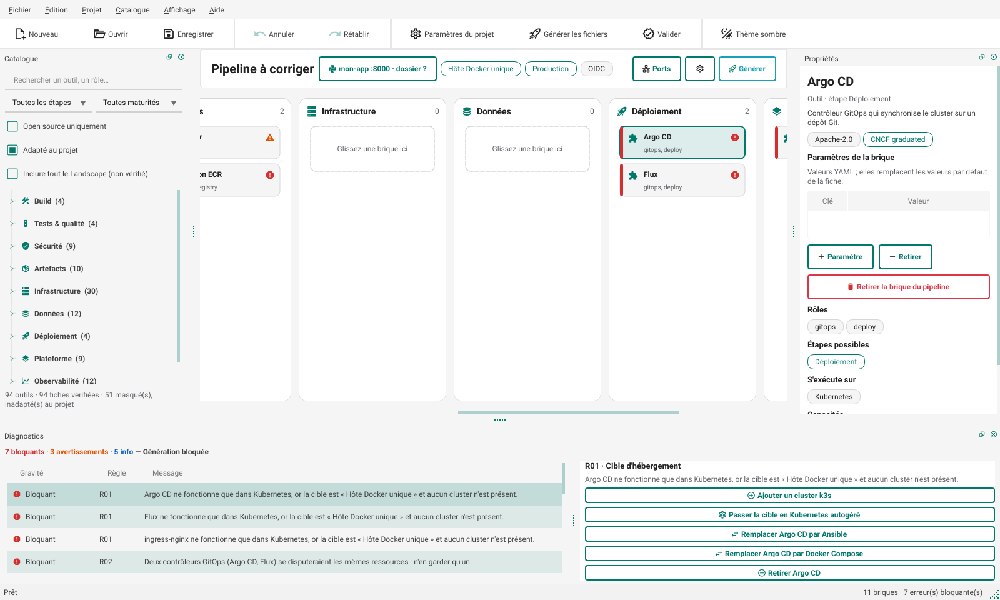

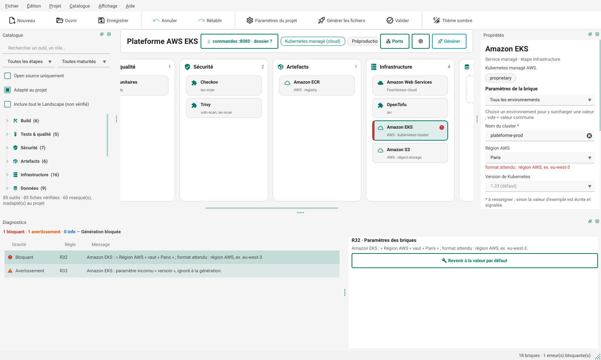

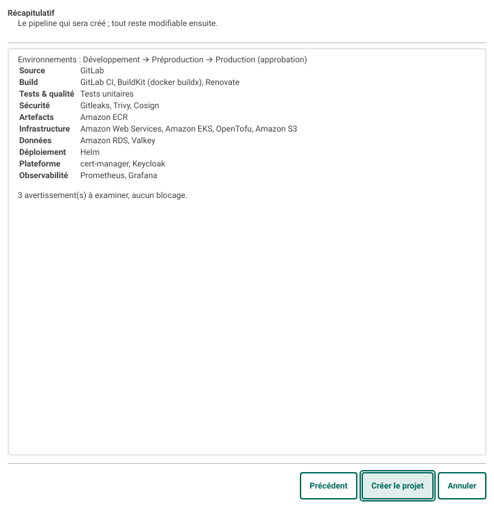

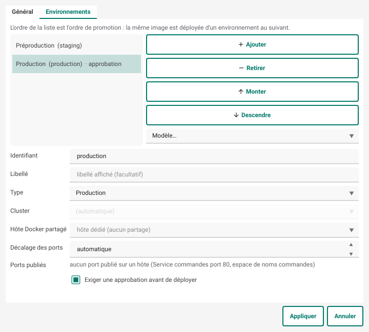

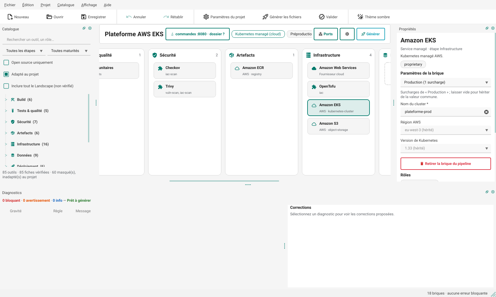

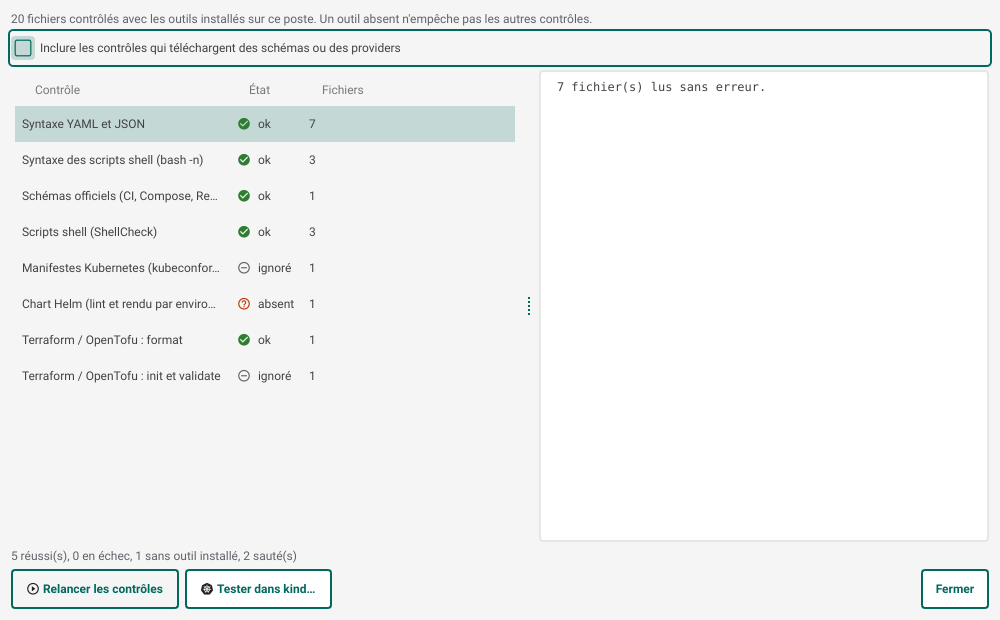

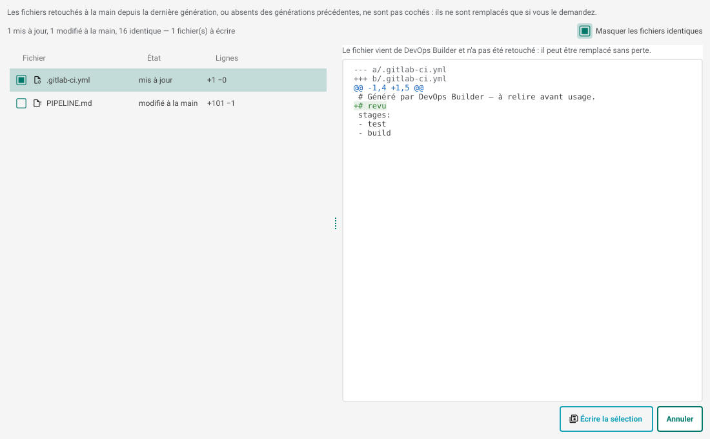

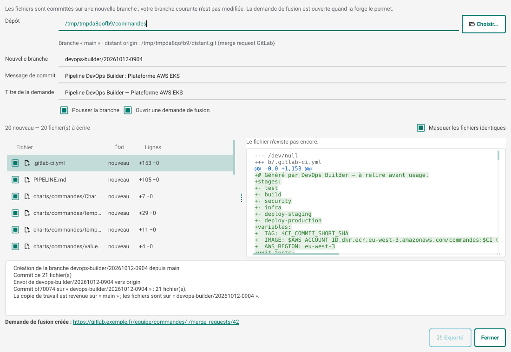

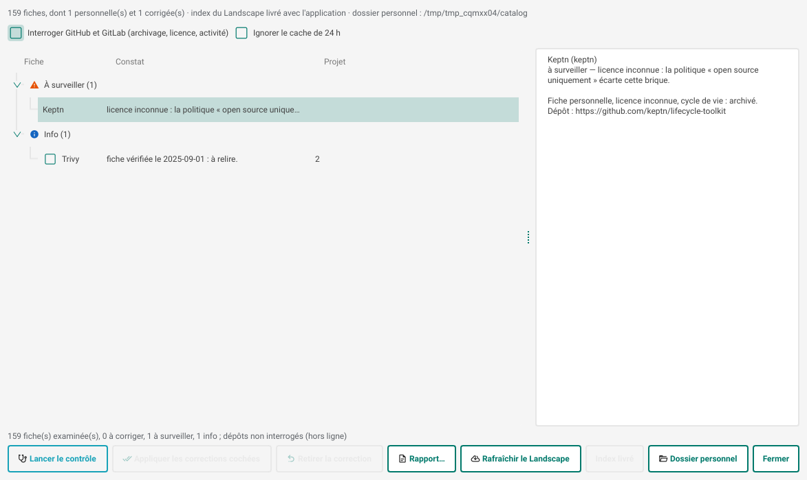

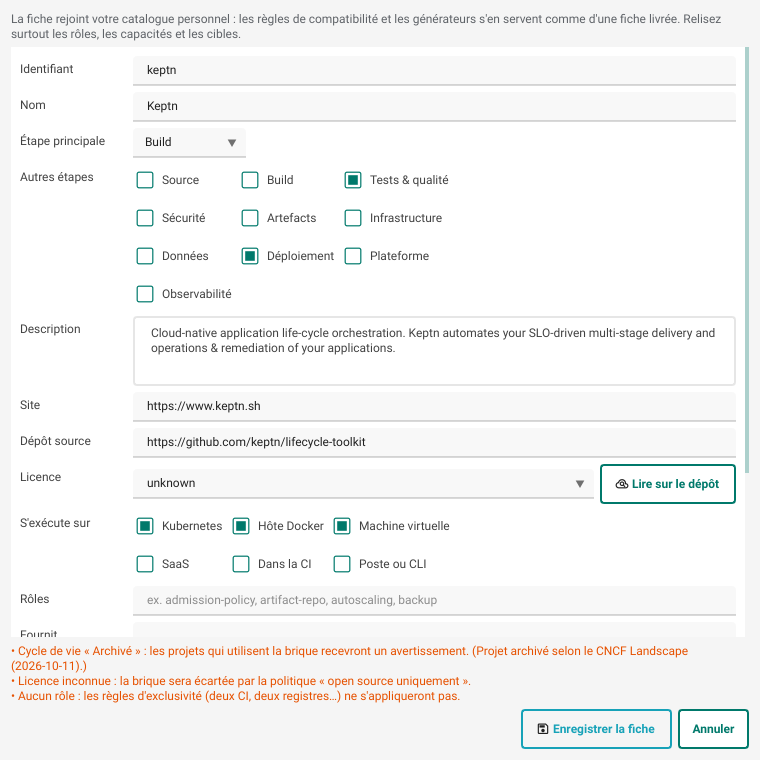

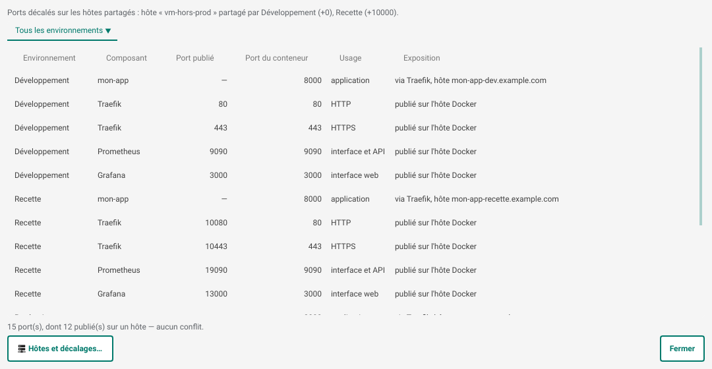

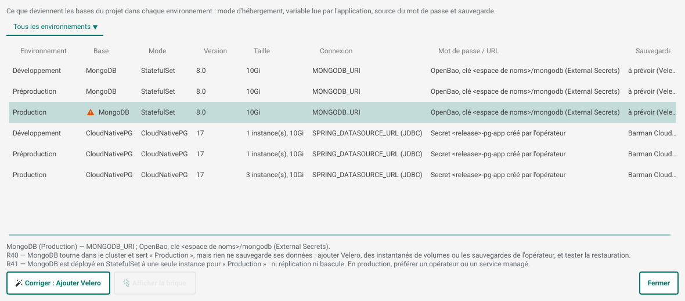

## Installation

Il faut Python 3.11 ou plus récent.

```bash
python -m venv .venv
source .venv/bin/activate          # Windows : .venv\Scripts\activate
pip install -e .                   # ou pip install -e ".[validate]" pour les linters Python
devops-builder                     # ou : python -m devops_builder
```

Sous Linux, Qt a besoin des bibliothèques système habituelles (`libxkbcommon`, `libEGL`, `fontconfig`).

## Utilisation

| Action | Comment |
| --- | --- |
| Ajouter une brique | Glisser depuis le catalogue, ou double-clic / Entrée |
| Déplacer une brique | Glisser vers une colonne compatible, ou Alt+← / Alt+→ (saute à l'étape autorisée suivante) |
| Retirer une brique | Suppr, ou bouton dans Propriétés |
| Corriger un diagnostic | Sélectionner le diagnostic puis cliquer une correction (Entrée applique la première) |
| Nouveau projet | Ctrl+N : assistant, qui commence par le dossier de l'application ; Ctrl+Maj+N : projet vide |
| Application | Ctrl+Maj+A, ou la carte de l'application dans la barre du projet : dossier, analyse, langage, port |
| Paramètres du projet | F2 : cible, langage, SecNumCloud, OIDC, politique de licence ; onglet Environnements (type, cluster, hôte Docker partagé, décalage des ports) |
| Ports | Ctrl+Maj+P, ou le bouton « Ports » de la barre du projet |
| Surcharger un paramètre | Sélectionner la brique, choisir l'environnement au-dessus du formulaire ; un champ vide hérite de la valeur commune |
| Générer | Ctrl+G : aperçu des fichiers, puis export vers Git, dans un dossier (avec différences) ou en .zip |
| Valider | Ctrl+Maj+V : contrôles locaux, puis test dans kind |
| Annuler / rétablir | Ctrl+Z / Ctrl+Y |
| Rechercher | Ctrl+F ; Ctrl+2 pour le pipeline, Ctrl+3 pour les diagnostics |
| Thème sombre | Ctrl+T |

Quatre projets d'exemple sont fournis dans **Fichier › Ouvrir un exemple** : un site web sur hôte Docker, une API sur k3s en GitOps, une plateforme AWS EKS en OpenTofu et une boutique avec PostgreSQL, Valkey et migrations sur un hôte partagé.

### En ligne de commande

```bash
devops-builder check projet.devops.yaml                 # --json ; code retour 1 si erreur bloquante
devops-builder generate projet.devops.yaml -o sortie/   # --dry-run, --overwrite, --force, --json
devops-builder validate projet.devops.yaml              # --offline, -v, --json ; code retour 1 si un contrôle échoue
devops-builder test-kind projet.devops.yaml --env dev --app-dir ../code
devops-builder export-git projet.devops.yaml --repo ../depot   # --branch, --no-push, --no-request
devops-builder catalog-check                            # --offline, --refresh, --apply, --report rapport.md
devops-builder catalog-import "Keptn"                   # --id, --stage, --license, --offline
devops-builder landscape-refresh                        # --source landscape.yml, --reset
devops-builder scan ../mon-app                          # --json : ce que l'analyse trouve
devops-builder init ../mon-app -o mon-app.devops.yaml   # --hosting, --cloud, --envs, --database
```

`generate` n'écrase plus les fichiers retouchés à la main : il les liste, et `--overwrite` les remplace.

Les codes de sortie (0 succès, 1 problème trouvé, 2 utilisation ou fichier illisible) et la sortie `--json` forment un contrat stable, décrit dans [docs/ligne-de-commande.md](docs/ligne-de-commande.md). Le format du fichier projet, ses migrations et la promesse de compatibilité sont dans [docs/format.md](docs/format.md) : un fichier de n'importe quelle version précédente s'ouvre, un fichier d'une version plus récente garde ses champs inconnus, un format plus récent est refusé avec un message clair. Les changements de chaque version sont dans [CHANGELOG.md](CHANGELOG.md).

## Ce qui est généré

| Domaine | Formats |
| --- | --- |
| CI | GitLab CI, GitHub Actions, Gitea Actions, Jenkinsfile, Woodpecker, Tekton, Azure Pipelines, AWS CodeBuild, Google Cloud Build |
| Déploiement | Docker Compose, chart Helm, Kustomize, Application Argo CD, Flux (GitRepository + Kustomization ou HelmRelease), playbooks Ansible |
| Données | Services Compose (volume, santé, `deploy/secrets.sh`, `scripts/db-backup.sh`, `scripts/db-restore.sh`), bases du poste (`dev/db/`), sauvegardes CloudNativePG (ObjectStore, ScheduledBackup, bucket et identité Terraform), StatefulSet et Secret dans le chart ou la base Kustomize, Cluster CloudNativePG, Terraform des bases managées (`outputs.tf`), service `migrate` ou initContainer de migrations |
| Mise en route | `docs/mise-en-route.md` : commandes de mise en place, dans l'ordre, propres au projet |
| Identité | Keycloak (service Compose et sa base, ou opérateur et ressource `Keycloak`), realm en Terraform (`infra/keycloak/`), Dex (chart ou service Compose), valeurs OIDC d'Argo CD et de Grafana, `auth/oidc` du coffre |
| Secrets | `.sops.yaml`, `scripts/secrets-fetch.sh`, `scripts/secrets-seed.sh` et `scripts/vault-setup.sh` (SOPS, Vault, OpenBao, coffres des clouds), `ClusterSecretStore` et `ExternalSecret` (chart ou overlays), configuration serveur de Vault et OpenBao (Compose), secrets écrits par Terraform dans AWS Secrets Manager, Google Secret Manager et Azure Key Vault, identité du contrôleur External Secrets (EKS Pod Identity, Workload Identity de GKE et d'AKS) |
| Infrastructure | Terraform / OpenTofu : machines de déploiement des six clouds (cloud-init, pare-feu, sortie `hosts`), providers épinglés, backend d'état chiffré et verrouillé (S3, GCS, Blob, Scaleway, OVHcloud, Outscale), ressources AWS, Google Cloud, Azure, OVHcloud, Scaleway, `outputs.tf`, `terraform.tfvars.example`, `.gitignore`, `.tflint.hcl` |
| Clusters autogérés | Scripts d'installation k3s, RKE2, kubeadm, MicroK8s, kind, minikube, réglés selon le CNI et l'entrée choisis (par exemple, k3s sans Flannel ni Traefik intégrés quand Cilium et Traefik sont dans le pipeline) |
| Plateforme | `platform/install.sh` (charts Helm officiels, sans réinstaller ce que le cluster fournit déjà) ou services Compose sur hôte Docker |
| Dépendances | `renovate.json`, `.github/dependabot.yml` (écosystèmes déduits du langage, du build, de la CI et de l'IaC) |
| Observabilité managée | Module CloudWatch sur EKS, Azure Monitor (Log Analytics) sur AKS ; Cloud Monitoring, intégré à GKE, est noté dans le rapport |
| Authentification cloud | OIDC par défaut : rôle IAM, Workload Identity Federation, fédération Entra ID |
| Outillage local | `scripts/tf-inventory.sh` (inventaire Ansible depuis les sorties Terraform), `scripts/test-kind.sh` (Helm ou Kustomize), `scripts/ci-variables.sh` (GitLab, GitHub, Gitea, Azure Pipelines), `scripts/tf-floci.sh` et `dev/floci/` (émulateur AWS) |
| Promotion | Un job de déploiement par environnement, enchaînés dans l'ordre. Approbation : job manuel (GitLab), environnement avec relecteurs (GitHub, Gitea, Azure Pipelines), `input` (Jenkins), événement manuel (Woodpecker), fichiers séparés à déclencher après validation (Tekton, CodeBuild, Cloud Build) |

Les fichiers générés sont un point de départ à relire. Les tests valident chaque sortie YAML contre les schémas officiels (GitLab CI, GitHub Workflows, Azure Pipelines, Cloud Build, Woodpecker, Compose, Renovate, Dependabot) et passent les workflows GitHub dans actionlint. `helm lint` n'est pas lancé par les tests ; `tofu validate` l'est sur toutes les piles de l'instantané quand `DEVOPS_BUILDER_TOFU_MIRROR` désigne un miroir local de providers (le module EKS, servi par le registre, y est remplacé par un module factice). Le bouton **Valider** lance les deux sur le poste quand les outils et le réseau sont disponibles.

## Organisation du code

```
devops_builder/
  model.py          fiches, projet, format .devops.yaml
  catalog.py        chargement des fiches + index du Landscape
  rules.py          moteur de règles, handlers génériques, corrections
  ir.py             représentation intermédiaire neutre du pipeline
  generators/       ci, deploy, data (bases), iac, platform, extras (dépendances, clusters), report
  ui/               interface PySide6 + qt-material
  params.py         validation et valeurs effectives des paramètres (surcharges par environnement)
  starter.py        assistant de démarrage : réponses → projet
  validate.py       contrôles locaux des fichiers générés
  sync.py           différences et écriture prudente (manifeste d'empreintes)
  gitexport.py      branche, commit, push, demande de fusion
  health.py         entretien du catalogue (Landscape, GitHub, GitLab.com)
  catalog_edit.py   fiches personnelles et corrections
  landscape.py      index du Landscape : construction, rafraîchissement, écarts
  userdata.py       dossier personnel (DEVOPS_BUILDER_HOME)
  ports.py          ports par environnement, hôtes partagés, conflits
  databases.py      bases du pipeline : moteurs, modes (autogérée, opérateur, managée), connexion
  appscan.py        analyse du dossier de l'application
  compat.py         briques adaptées au projet (filtre de la palette)
  data/ports.yaml   ports par défaut des briques et leur usage
  suggest.py        briques souvent associées
  data/catalog/     fiches YAML (une par outil)
  data/params.yaml  schémas des paramètres de briques
  data/suggestions.yaml  briques souvent associées
  data/rules/       une règle YAML par fichier
  data/examples/    projets de référence
tools/
  build_landscape_index.py   rafraîchit l'index depuis landscape.yml
  screenshot.py              captures hors écran de l'interface
tests/              règles, générateurs, interface (hors écran), non-régression
  golden/           sorties figées de 156 projets (exemples, matrice, échantillon de l'assistant, environnements, ports, données, IaC, Floci, Ansible et machines)
  data/legacy/      projets enregistrés par les versions 0.1, 0.3, 0.7 et 0.8
  minihelm.py       rendu des gabarits Helm générés, sans le binaire helm
tools/compare_captures.py  écart visuel entre deux séries de captures
```

### Ajouter un outil

Pour un usage personnel ou d'équipe, passer par le catalogue personnel (palette › clic droit › Créer une fiche, ou `devops-builder catalog-import`). Pour l'ajouter à l'application, ajouter une entrée dans un fichier de `data/catalog/` : étape principale (`stage`) et, s'il le faut, étapes secondaires (`extra_stages`), rôles, cibles (`hosting`), capacités fournies et requises, forge, fournisseur, cycle de vie, date de vérification. Le schéma est validé au chargement.

Si l'outil a des réglages, décrire ses paramètres dans `data/params.yaml` : libellé, type, valeur par défaut (`{app}` = nom de l'image du projet), valeur d'exemple, liste de choix ou de suggestions, motif et explication du format. Le formulaire et les règles R32 à R34 s'en déduisent. Une valeur par défaut qui ne respecte pas son propre motif est refusée au chargement.

Un outil ne peut être posé que dans `stage` ou `extra_stages`. Par exemple, Ansible va en Infrastructure ou Déploiement, et Trivy en Sécurité ou Tests & qualité. Les entrées non vérifiées du Landscape reçoivent des étapes déduites de leur sous-catégorie. La règle R25 bloque la génération si un fichier `.devops.yaml` édité à la main place une brique ailleurs, et propose de la déplacer.

### Ajouter une règle

Créer `data/rules/R45_....yaml` avec un `type` existant (`exclusive_role`, `conflict_pair`, `requires`, `requires_generic`, `lifecycle`, `target_mismatch`, `params`…), puis ajouter son cas dans `tests/test_rules.py`. Un nouveau type de règle s'écrit comme un handler dans `rules.py`.

### Rafraîchir le Landscape

Depuis l'application ou avec `devops-builder landscape-refresh`, pour son propre index. Pour l'index livré avec l'application :

```bash
curl -LO https://raw.githubusercontent.com/cncf/landscape/master/landscape.yml
python tools/build_landscape_index.py landscape.yml
```

Les deux signalent les entrées ajoutées, retirées et nouvellement archivées, pour savoir quelles fiches revoir.

## Tests

```bash
pip install -e ".[dev]"
QT_QPA_PLATFORM=offscreen pytest
```

823 tests : un par règle, l'application de chaque correction proposée, une matrice de combinaisons CI × déploiement × cloud × environnements validées contre les schémas, avec contrôle qu'aucune brique n'y reste sans fichier, les 15 300 combinaisons de l'assistant (aucune ne doit produire d'erreur bloquante), la validation, l'écriture prudente, l'export Git vers des dépôts locaux (dont les options de push GitLab), les scripts kind et variables CI contre des outils factices et une fausse API Gitea, l'entretien du catalogue contre une fausse API GitHub et GitLab, l'analyse d'applications Python, Node.js, Java, Go et .NET (dont leurs bases et migrations), les bases de données sur chaque cible (rendu du chart, Kustomize, script de secrets exécuté, format Terraform), l'état et les variables Terraform de chaque cloud, Floci dans chaque CI, les playbooks Ansible passés à `--syntax-check` et ansible-lint, les machines de chaque cloud et le script d'inventaire contre une sortie Terraform simulée, l'identité (realm appliqué à un vrai Keycloak 26.8 puis relu sans écart, connexion OIDC à OpenBao d'un membre du groupe admins et refus d'un non-membre, ressource Keycloak contre le schéma de sa CRD), les données (sauvegarde puis restauration contre un vrai PostgreSQL, formats de connexion dans chaque cible, ressources CloudNativePG contre les schémas des CRD), les secrets (SOPS chiffré puis déchiffré avec age, écriture et lecture contre un faux Vault avec connexion JWT, ExternalSecret rendus dans le chart et les overlays, secrets écrits par Terraform pour chaque cloud, `vault-setup.sh` contre un faux coffre qui enregistre ses appels, mode d'emploi dont chaque commande passe `bash -n` et ShellCheck), la prise en charge déclarée de chaque fiche confrontée aux générateurs (projets de référence et sondes par cible), le contrat de la ligne de commande (codes de sortie, sortie `--json`, fichiers illisibles), la cohérence entre l'assistant et le filtre de la palette, le catalogue personnel et le rafraîchissement du Landscape, et l'interface pilotée hors écran : glisser-déposer, formulaire de paramètres, surcharges, éditeur d'environnements, assistant, dialogues de validation, de différences, d'export, d'entretien, de fiche, de ports et d'application, et la largeur minimale de la fenêtre (1 280 px au plus). Toute exception levée dans un slot Qt fait échouer le test en cours. Les tests utilisent un dossier personnel jetable : un catalogue personnel présent sur le poste ne les influence pas.

### Non-régression

`tests/test_regression.py` compare tout ce que génèrent 174 projets (fichiers et diagnostics) à l'instantané de `tests/golden/`, et recharge les projets enregistrés par chaque version précédente (`tests/data/legacy/`, de la 0.1 à la 0.15 : ouverts, contrôlés, générés, réenregistrés sans perte de valeur). À chaque version, des fichiers écrits par la précédente rejoignent ce corpus ; un test le vérifie. Après un changement voulu :

```bash
UPDATE_GOLDEN=1 pytest tests/test_regression.py
git diff tests/golden          # chaque ligne changée doit s'expliquer
```

Pour l'interface, `tools/screenshot.py` refait les captures et `tools/compare_captures.py docs/captures nouvelles/` mesure l'écart avec celles de la version précédente.

## Limites connues

- Les fiches sont datées du 8 octobre 2026 ; le cycle de vie des outils évolue vite (ingress-nginx, Kaniko, AWS App Mesh, Google Container Registry y sont déjà signalés).
- Bases de données : les gabarits Helm sont vérifiés par un rendu interne (`tests/minihelm.py`) puis kubeconform, pas par `helm template` ; les ressources Terraform des bases managées par `tofu fmt`, pas par `tofu validate` (registres de providers injoignables pendant les tests). Sur un service serverless (Cloud Run, ECS, Azure Container Apps), l'URL de connexion se branche à la main ; `PIPELINE.md` donne la commande, et avec le coffre du cloud la pile Terraform y écrit déjà l'URL. Le mot de passe d'une base autogérée se limite aux caractères sûrs dans une URL (lettres, chiffres, `. _ ~ -`).
- Identité : Dex n'a été vérifié que sur sa configuration (pas d'exécution) ; Harbor et SonarQube reçoivent leur client OIDC mais se branchent dans leur administration ; avec Dex, le groupe d'administration est le groupe de la forge (paramètre « Groupe ou organisation »). La base de Keycloak sans CloudNativePG est un StatefulSet à une instance.
- Secrets : l'initialisation et le descellement du coffre restent manuels (clés à garder hors de l'hôte), tout comme la création d'un accès d'administration nominatif avant de révoquer le jeton racine. Avec un coffre du cloud sur un cluster d'un autre fournisseur (k3s, Kapsule…), l'identité d'External Secrets reste à poser à la main. Les droits donnés à la CI par le mode d'emploi (AdministratorAccess, Editor, Contributor) sont larges, pour que le premier apply passe : à restreindre ensuite. La connexion par JWT n'est générée que pour GitLab CI et GitHub Actions (les autres CI passent par `VAULT_TOKEN`). SOPS est réglé pour age seulement. Les secrets écrits par Terraform passent par l'état : backend chiffré à accès restreint. Les ressources External Secrets ont été validées contre les schémas des CRD, les scripts contre OpenBao 2.4, SOPS 3.11 et age, sans cluster réel.
- Terraform : azurerm reste en 4.x (la 5.0 de juillet 2026 change des schémas, migration à valider). Les backends Scaleway, OVHcloud et Outscale n'ont pas de verrou d'état : la CI sérialise les apply, mais deux apply lancés à la main en même temps restent possibles. Un seul état porte tous les environnements.
- Machines : le réseau est celui par défaut du cloud (VPC par défaut d'AWS, réseau « default » de Google Cloud) ou un réseau minimal (Azure) ; pas d'adresse IP fixe hors Azure et Outscale, ni d'équilibreur de charge. Les instances OVHcloud n'ont pas de pare-feu : le poser à la main. Le premier déploiement suppose l'apply de la pile déjà fait. La création des machines n'a été vérifiée que par `tofu validate`, sans apply réel.
- Floci : dans la CI, l'émulateur tourne sans socket Docker ; le plan passe, mais EKS, RDS ou Lambda ne peuvent être créés qu'en local, et un `apply` sur Floci échoue sur les ressources qui référencent un réseau existant (VPC, groupe de sous-réseaux) donné par une valeur factice. Jenkins, Tekton, Azure Pipelines, CodeBuild et Cloud Build ne démarrent pas Floci (`PIPELINE.md` le signale).
- OKS (Outscale) et Azure Container Apps n'ont pas de ressource Terraform générée : seul un commentaire est écrit, et R31 les signale. La prise en charge d'OKS par le provider `outscale/outscale` reste à vérifier.
- RKE2 : le contrôleur d'entrée embarqué dépend de la version ; le script indique comment le désactiver mais ne le fait pas.
- Renovate hors GitHub : `renovate.json` est généré, mais le job planifié qui lance Renovate reste à créer (expliqué dans `PIPELINE.md`).
- Argo CD et Flux : avec un cluster par environnement, les clusters distants doivent être enregistrés auprès de l'instance GitOps (`argocd cluster add`, ou un Flux par cluster) ; c'est indiqué dans `PIPELINE.md`.
- Woodpecker, Tekton, CodeBuild et Cloud Build n'ont pas de porte d'approbation native : la production part d'un déclenchement manuel ou d'un fichier séparé, et la restriction de qui peut le lancer se règle dans l'outil.
- Le contrôle Helm demande `helm` sur le poste, et le test kind demande Docker, kind et kubectl. Le script kind a été vérifié en dry-run contre un vrai serveur d'API Kubernetes, et son déploiement complet seulement avec des outils factices.
- `scripts/ci-variables.sh` ne couvre pas Jenkins, Woodpecker, Tekton, CodeBuild ni Cloud Build : leurs secrets restent à déclarer à la main (liste dans `PIPELINE.md`).
- Export Git : la pull request GitHub demande `gh auth login` ; sans cela, et pour Gitea, Bitbucket et Azure DevOps, il faut cliquer le lien de création proposé.
- Une brique issue du Landscape sans fiche n'est contrôlée par aucune règle et ne produit aucun fichier : en faire une fiche personnelle. Une fiche personnelle est contrôlée par les règles, mais aucun générateur ne la connaît : elle apparaît dans « À configurer à la main ».
- L'entretien n'interroge que GitHub et GitLab.com ; un dépôt hébergé ailleurs (Gitea, Codeberg, GitLab autohébergé) n'est suivi que par le Landscape et la date de vérification.
- L'authentification cloud par OIDC n'est générée que pour GitLab CI et GitHub Actions. Gitea Actions reprend les actions GitHub, mais l'émission du jeton dépend de l'instance. Jenkins, Woodpecker, Tekton, Azure Pipelines et Cloud Build reposent sur des secrets ou sur l'identité du service.
