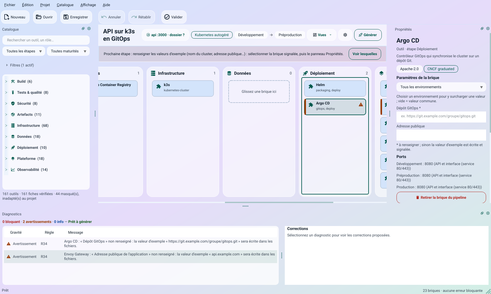

# Prise en main de l'interface

## Par où commencer

À l'ouverture, un projet vide n'affiche qu'un écran **Par où commencer ?** : l'assistant (conseillé si on débute),
un modèle de fournisseur cloud, un exemple, un projet enregistré, ou « Construire à la main » qui ouvre le
catalogue. Les panneaux (catalogue, propriétés, diagnostics) n'apparaissent qu'avec la première brique.

Ensuite, un bandeau **Prochaine étape**, sous la barre du projet, indique le seul geste utile du moment, avec son
bouton : corriger les erreurs bloquantes, renseigner les valeurs d'exemple (R34), désigner le dossier de
l'application, puis générer.

## Les zones de l'écran

**Barre du projet** (en haut du centre) : le nom du projet ; la carte de l'application (dossier analysé,
langage, port — Ctrl+Maj+A) ; des puces qui résument la cible, les environnements et l'authentification de la
CI ; le bouton **Vues** (réseau, ports et données par environnement) ; les paramètres du projet (F2) ; **Générer**.

**Pipeline** (au centre) : une colonne par étape, de la source à l'observabilité — Source, Build, Tests &
qualité, Sécurité, Artefacts, Infrastructure, Données, Déploiement, Plateforme, Observabilité. Chaque brique
affiche son nom, son rôle et, si un diagnostic la concerne, l'icône de sa gravité.

**Catalogue** (à gauche) : les outils vérifiés, rangés par étape, avec une recherche (Ctrl+F) et des filtres :
étape, maturité CNCF, puis, repliés sous **Filtres** : open source uniquement, « Adapté au projet » (masque ce que le projet écarterait :
cible, forge, licence, SecNumCloud, cloud, rôle déjà tenu) et « Inclure tout le Landscape » (les ~1 000 entrées
du CNCF Landscape, sans fiche de compatibilité).

**Propriétés** (à droite) : la fiche de la brique sélectionnée (licence, maturité, prise en charge, ce qu'elle
fournit) et le formulaire de ses paramètres. Au-dessus du formulaire, le choix de l'environnement permet de
**surcharger** une valeur pour un seul environnement ; un champ laissé vide hérite de la valeur commune.

**Diagnostics** (en bas) : les règles de compatibilité qui s'appliquent au projet, avec leur gravité. Le
diagnostic sélectionné montre ses corrections à droite ; Entrée applique la première. Toute correction
s'annule par Ctrl+Z.

**Barre d'état** (tout en bas) : le dernier message (brique ajoutée, déplacée, refusée…) et le compte des
briques et des erreurs bloquantes. Les lecteurs d'écran annoncent ces messages.

## Construire au clavier

Tout se fait sans souris ; le glisser-déposer a toujours son équivalent clavier.

| Action | Clavier |
| --- | --- |
| Rechercher dans le catalogue | Ctrl+F, puis Tab jusqu'à l'arbre |
| Ajouter l'outil sélectionné à son étape | Entrée (ou double-clic) |
| Aller au pipeline, aux diagnostics | Ctrl+2, Ctrl+3 |
| Changer une brique d'étape | Alt+← ou Alt+→ (saute à l'étape autorisée suivante) |
| Déplacer une brique dans son étape | Alt+↑ ou Alt+↓ |
| Retirer une brique | Suppr |
| Appliquer la première correction d'un diagnostic | Entrée sur le diagnostic |
| Annuler, rétablir | Ctrl+Z, Ctrl+Y |
| Nouveau projet (assistant), projet vide | Ctrl+N, Ctrl+Maj+N |
| Ouvrir, enregistrer | Ctrl+O, Ctrl+S |
| Paramètres du projet | F2 |
| Application, ports, données, réseau | Ctrl+Maj+A, Ctrl+Maj+P, Ctrl+Maj+D, Ctrl+Maj+R |
| Générer, valider | Ctrl+G, Ctrl+Maj+V |
| Thème sombre | Ctrl+T |
| Thème Verre | Ctrl+Maj+T |
| Agrandir, réduire le texte | Ctrl++, Ctrl+- |

Une brique ne peut être posée que dans une étape qui l'accepte : un dépôt refusé, au clavier comme à la souris,
dit pourquoi dans la barre d'état.

## Affichage

- **Thème sombre** : Affichage › Thème sombre (Ctrl+T).
- **Thème Verre** : Affichage › Thème Verre (Ctrl+Maj+T) : panneaux translucides sur un fond en dégradé. C'est une
  imitation dessinée par l'application, identique sur Windows, macOS et Linux ; ce n'est pas l'effet natif de
  macOS 26. Les panneaux restent assez opaques pour que le texte garde son contraste.
- Les trois thèmes respectent les contrastes minimaux (4,5:1 pour le texte, 3:1 pour les icônes et l'indicateur
  de focus) ; le choix est retenu d'une session à l'autre.

- **Taille du texte** : Affichage › Taille du texte, de 100 à 200 %. Le choix est retenu d'une session à
  l'autre ; à 150 % et plus, le nom du projet passe sur sa propre ligne.
- **Focus** : le contrôle actif est entouré d'un anneau de deux pixels dans la couleur principale du thème.
- **Panneaux** : Affichage permet de masquer ou de rétablir le catalogue, les propriétés et les diagnostics ;
  chaque panneau peut aussi être détaché.

## Lecteurs d'écran

L'interface expose son arbre d'accessibilité aux lecteurs d'écran : NVDA et le Narrateur (Windows) le lisent
par UI Automation, Orca (Linux) par AT-SPI, VoiceOver (macOS) par l'API d'accessibilité d'Apple. Les deux
premiers arbres sont vérifiés à chaque modification du code ; VoiceOver ne l'est pas encore. Chaque
contrôle a un nom, les briques sont annoncées avec leur niveau de prise en charge et la gravité de leur
diagnostic (« Trivy, info »), les messages de la barre d'état sont lus sans déplacer le focus. Le détail des
contrôles et leurs limites : [Accessibilité de l'application](../accessibilite.md).

## Ouvrir un projet existant

Fichier › Ouvrir (Ctrl+O), ou depuis un terminal : `devops-builder mon-projet.devops.yaml`. Un fichier écrit par
une version plus ancienne s'ouvre sans perte ; un fichier modifié à la main qui contient une erreur est refusé
avec un message qui dit où et pourquoi (« YAML invalide ligne 12, colonne 3 : tabulation interdite en YAML :
indenter avec des espaces »). Sept exemples sont livrés dans Fichier › Ouvrir un exemple.

## Simuler une modification d'architecture

Ouvrir un projet, le modifier (changer l'hébergement, retirer ou ajouter une brique, passer une CI à une autre),
puis **Projet › Comparer avec le point de départ** (Ctrl+Maj+C). Le rapport montre ce qui change : réglages et
environnements, briques ajoutées, retirées, déplacées ou modifiées (avec la valeur avant et après), diagnostics
apparus ou résolus, ports publiés et fichiers générés (lignes ajoutées et retirées). Il s'enregistre en Markdown
pour être joint à un compte rendu.

Le point de départ est l'état du projet à l'ouverture ; **Prendre l'état actuel comme point de départ** le remplace
(pratique pour comparer plusieurs variantes de suite). **Comparer avec un autre projet…** prend un fichier
`.devops.yaml` comme état de départ, par exemple l'architecture actuelle d'un client. En ligne de commande :
`devops-builder compare avant.devops.yaml apres.devops.yaml`.

## Plusieurs applications dans un projet

Application › « Applications supplémentaires » ajoute à l'application principale une API, une interface, un worker…
Chaque composant a son identifiant, son langage, son port et son dossier dans le dépôt (par défaut
`services/<identifiant>`, avec son propre Dockerfile).

Le pipeline construit, teste et analyse chaque composant : une image par composant, dans le même dépôt du registre,
avec l'étiquette `<identifiant>-<commit>`. Le déploiement les livre ensemble :

- **Docker Compose** (SSH ou Ansible) : un service par composant ; l'application principale les joint par leur nom
  (variable `API_URL=http://api:9000`). Un composant « exposé » est routé par Traefik sur `/<identifiant>` (préfixe
  retiré avant d'arriver au service), ou publié sur l'hôte sans Traefik.
- **Helm** : un Deployment et un Service par composant dans le même chart (`components.<id>` dans `values.yaml`).

Kustomize, Argo CD, Flux, ECS Fargate, Cloud Run, Azure Container Apps et les fonctions serverless ne livrent pas
encore plusieurs applications : la règle R60 le signale et bloque la génération. Le test kind jetable n'est pas
généré avec des composants (il ne construit que l'application principale). Un exemple est livré : « Boutique en
plusieurs applications ».

## Un hébergement par environnement (hybride)

Dans Projet › Environnements, le champ « Hébergement » laisse un environnement être hébergé autrement que le reste du
projet : développement sur un hôte Docker (Docker Compose), préproduction et production sur Kubernetes (Helm), par
exemple. Chaque environnement reçoit l'étape de déploiement de son hébergement, la même image est promue de l'un à
l'autre, les ports ne sont publiés que sur les hôtes Docker, et le rapport ajoute une colonne « Hébergement ».

La règle R61 vérifie que les briques de chaque hébergement sont présentes (Docker Compose pour un hôte ; un cluster et
Helm ou Kustomize pour Kubernetes). Limites : le mode d'une base de données (conteneur Compose ou Kubernetes) suit le
projet entier — R61 le signale ; le guide `docs/mise-en-route.md` décrit l'hébergement du projet. Exemple livré :
« Hybride : hôte Docker puis Kubernetes ».
