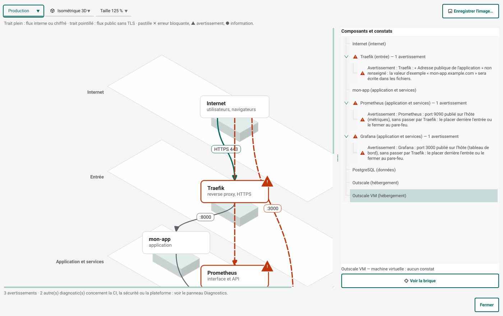

# Le schéma réseau

**Vues › Réseau** (Ctrl+Maj+R) dessine le réseau d'un environnement : qui est joint depuis Internet, par où, ce
qui parle à quoi, et où sont les erreurs. Le schéma se tire du projet : il suit chaque modification.

## Deux affichages

- **Plan 2D** : un plan par bande, de haut en bas : Internet, entrée (Traefik, Ingress), application et services,
  données, hébergement (fournisseur cloud, cluster, machine). Les flèches portent le port.
- **Isométrique 3D** : les mêmes plans, empilés, pour lire d'un coup d'œil ce qui traverse quoi. Le choix est
  retenu d'une session à l'autre.

L'environnement se choisit en haut (la production par défaut), ainsi que la **taille du schéma** (100 à 200 % : textes et
espaces suivent, le dessin défile s'il dépasse la fenêtre) ; **Enregistrer l'image…** écrit le schéma en PNG,
pour un dossier d'architecture ou une revue.

## Qui est derrière qui

Sur un hôte Docker avec Traefik, seule l'entrée est ouverte sur Internet. Les interfaces web (Grafana, SonarQube,
Jenkins, Gitea, console MinIO, interface Jaeger, registres Zot et Distribution) sont derrière Traefik : une flèche
part de l'entrée vers chacune, en HTTPS, à l'adresse `<outil>.<domaine des outils>` (ou le paramètre « Adresse
publique » de la brique). Prometheus et Loki n'ont pas d'authentification : ils restent sur le réseau interne et
seul Grafana les interroge. Les ports « machine » (OTLP, SSH de Gitea, API S3 de MinIO) restent publiés, avec
une flèche directe depuis Internet. Sans Traefik, ces interfaces sont publiées sur l'hôte et le schéma le signale.

Sur Kubernetes, le contrôleur d'entrée est celui du pipeline : Traefik, ingress-nginx (Ingress) ou Envoy Gateway
(Gateway API). Il porte l'application et les interfaces web de Grafana, SonarQube, Jenkins, Gitea, Zot, Harbor, Argo CD,
Argo Workflows, Chaos Mesh et Jaeger ; le
schéma tire une flèche de l'entrée vers chacun. Avec cert-manager dans le pipeline, l'entrée sert l'application et
les interfaces en HTTPS (certificats Let's Encrypt, `platform/cluster-issuer.yaml`) ; sans lui, elle reste en HTTP
et la règle R54 propose de l'ajouter.

## Plusieurs instances d'un même outil

Les outils qui s'y prêtent (Grafana, Gitea, SonarQube, Jenkins, Zot, MinIO, Prometheus, Loki, Jaeger, Tempo,
OpenSearch, collecteur OpenTelemetry…) peuvent être posés plusieurs fois. Dans l'application : ajoutez l'outil une
deuxième fois (glisser-déposer ou double-clic dans la palette), saisissez le nom de la nouvelle instance, ou
renommez une brique dans ses propriétés (champ « Nom de l'instance »). Chaque instance reçoit son identifiant
(`grafana-equipe-b`), son service Compose ou sa release Helm, ses volumes, sa configuration d'environnement, son
adresse (`grafana-equipe-b.<domaine>` derrière l'entrée) et, sans entrée, ses ports publiés décalés de 100 par rang.
Sur Kubernetes, l'instance nommée est installée dans l'espace de noms du chart suffixé de son nom. Le schéma
montre un nœud « Grafana (equipe-b) » par instance. La règle R55 signale un nom invalide ou en double, et un outil
qui n'accepte qu'une instance. Limites : la connexion unique (SSO) n'est branchée qu'à l'instance principale.

## Une base de données par outil

Gitea, SonarQube et Grafana démarrent par défaut sur leur base intégrée (SQLite, H2 pour SonarQube), pratique pour
essayer mais pas pour la production. Dans les propriétés de la brique, « Base de données » = `postgresql` leur donne
un PostgreSQL à eux, une par instance (deux Gitea, deux bases). Sur un hôte Docker, le service `<outil>-db` a son
volume et son mot de passe (variable `<OUTIL>_DB_PASSWORD`, écrite par `deploy/secrets.sh`) ; la base n'est jamais
publiée sur l'hôte. Sur Kubernetes, `platform/db-<outil>.yaml` crée un Cluster CloudNativePG (ajouter la brique
CloudNativePG) ou, sans l'opérateur, un StatefulSet, et `platform/install.sh` règle le chart de l'outil. Les clés
Helm viennent de la documentation des charts : à vérifier à la première installation.

## Adresses : noms DNS et adresses IP

Les registres peuvent être désignés par une IP (`192.168.1.20:5000`). Sans HTTPS, Docker, BuildKit et k3s refusent
par défaut de s'y connecter : pour Harbor, Zot et Distribution sur une IP ou `localhost`, les fichiers générés
déclarent le registre (Ansible : `insecure-registries` ; k3s : `deploy/registries.yaml` à copier dans
`/etc/rancher/k3s/registries.yaml` sur chaque nœud) et une note décrit le réglage de la CI.

Les adresses publiques des outils (Grafana, Gitea, l'application…) et le domaine des outils doivent être des
noms DNS : un Ingress ou une Gateway Kubernetes refuse une IP, Let's Encrypt ne délivre pas de certificat pour
elle avec la configuration générée, et une IP ne peut pas porter plusieurs noms. La règle R56 le signale. En réseau
local, déclarer un nom dans le DNS de la box, dans un Pi-hole ou dans `/etc/hosts`, ou utiliser un domaine
`nip.io` / `sslip.io` (`grafana.192.168.1.20.nip.io` pointe sur `192.168.1.20`), en restant en HTTP.

## Lire les erreurs sur le schéma

Une pastille sur un composant dit qu'un constat le concerne : **disque barré** pour une erreur bloquante,
**triangle** pour un avertissement, **disque** pour une information. Le contour du composant prend la couleur de la
gravité, mais la forme et le texte suffisent : la liste de droite écrit chaque constat.

Deux sortes de constats se posent sur le schéma :

- ceux des **règles** du projet (R34 : valeur d'exemple à renseigner ; R39 : deux services sur le même port ;
  R52 : machine trop petite…), rattachés au composant de la brique concernée. Une règle propre à un environnement
  n'apparaît que sur cet environnement ;
- ceux du **réseau**, qui n'ont de sens que sur le schéma : un service publié sur l'hôte sans passer par l'entrée
  (Grafana et Prometheus, par exemple), une application exposée en HTTP simple, un cluster sans point d'entrée.

Les diagnostics qui ne touchent aucun composant (CI, sécurité, plateforme) restent dans le panneau Diagnostics ;
le bas de la fenêtre en donne le nombre.

## Agir depuis le schéma

- Cliquer un composant (ou ← → ↑ ↓ au clavier) le sélectionne dans le dessin et dans la liste, et annonce ses
  constats aux lecteurs d'écran.
- Choisir un constat dans la liste affiche son message, sa source (« règle R52 », « réseau ») et, quand la règle en
  propose une, un bouton **Corriger** : la correction s'applique au projet (Ctrl+Z l'annule) et le schéma se met à
  jour.
- **Voir la brique** (ou Entrée, ou un double-clic) ferme le schéma et sélectionne la brique dans le pipeline.

La liste « Composants et constats » donne la même information que le dessin, en texte : c'est elle que les
lecteurs d'écran et le clavier parcourent.
